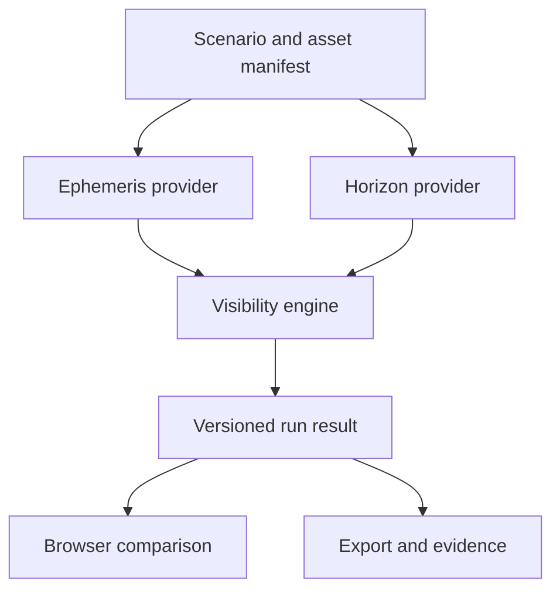

# Lunar Landing Site Navigator — Master Reference

**Revision:** 0.5 · 14 November 2026

**Status:** Proposed design for the fresh hackathon repository

**Working window:** 36 hours from local kickoff. The timeline workbook controls task hours and dependencies.

**Owners:** Team lead for scope and schedule. Science lead for scientific claims. Engineering, UI, and QA leads for their interfaces and checks.

<a id="ref-start"></a>

## 1. How to use this reference

At kickoff, confirm the event brief (§2) and choose the first demo case (§3 and §12). Engine and UI can then agree on the saved result (§5). At freeze, use §9 and §10 to decide what to show and what the team can substantiate.

| Decision | Where it lives |
|---|---|
| Event rules, required outputs, and eligible resources | Official challenge brief and local organizer instructions |
| Behavior, defaults, and criteria for changing them | This reference and its decision log |
| Task sequence, ownership, and actual hours | [Lunar-Hackathon-Timeline.xlsx](https://chatgpt.com/library?file_id=libfile_8458ee7ff2408191a1a4ff57126a9cc5&account_id=personal), **Tasks** tab |
| What ran and what passed | Fresh-repo tests, run manifests, and freeze evidence |
| How Cursor works on a task | The assigned task ID and the relevant sections here. Project rules and skills link to them. |

A **requirement** governs behavior or a claim. A **default** is a replaceable starting choice. An **open decision** needs an owner and an answer at the relevant milestone.

**Quick navigation** [Solution](#ref-solution) · [Architecture](#ref-architecture) · [Contracts](#ref-contracts) · [Angles and math](#ref-math) · [Worked cases](#ref-worked-example) · [Horizons replay](#ref-practice) · [Workbench](#ref-workbench) · [Offline setup](#ref-inputs) · [Timeline](#ref-timeline) · [Tasks](#ref-task-plan) · [Evidence](#ref-evidence) · [Upgrades](#ref-upgrades) · [Cursor handoff](#ref-agent) · [File catalog](#ref-appendix-inventory) · [Practice data](#ref-appendix-practice)

The three files carry the same reference. Edit the Markdown, open the HTML directly from the USB for the charts, or use the JSON to search by section, task, contract, source or fixture. The HTML embeds its chart images and styles. The source and team-file links open online. The workbook controls scheduling if the team revises the plan.

<a id="ref-fresh-start"></a>

## 2. Fresh-start boundary

Start the implementation in a **fresh repository at official kickoff**. The earlier lunar-landing-site-navigator repository is simulation and educational history. The owner plans to archive it or make it private. Keep the archive out of the submission build and create fresh code, UI, validation runs, and demo evidence during the event. Use public inputs and third-party tools under the event rules and their own terms.

At M0.1, confirm local kickoff, cutoff, submission format, permitted resources, and AI-use disclosure. The indexed official brief asks for a quick way to compare lunar landing sites and dates using Sun and Earth positions relative to the horizon. The challenge page could not be opened directly during this review. Confirm its live details and Resources tab at kickoff. The Global Organizing Team says Global Awards entries need at least one NASA data source from the challenge's Resources list. Record the eligible source used in the submitted build. [Challenge brief](https://www.spaceappschallenge.org/2026/challenges/lunar-landing-site-navigator/) · [Resources tab](https://www.spaceappschallenge.org/2026/challenges/lunar-landing-site-navigator/?tab=resources) · [Organizer guidance](https://github.com/nasa/spaceapps/discussions/1827) · [AI use and disclosure](https://github.com/nasa/spaceapps/discussions/1849)

The team's simulation exposed three failure modes worth testing again. A populated azimuth bin can still have a large gap along the ray. A consistent coordinate round trip can still leave the frame tie and height zero unresolved. A browser demo that works with a warm CDN cache can fail at the venue. The simulation repository and its benchmark notes may require team access. Link fresh evidence to each submitted claim. Keep the old code, notebooks, team-produced UI assets, benchmark outputs and deployments outside the fresh implementation and submission evidence.

### What the simulation checked

| Prior work | What the fresh build should check |
|---|---|
| Six SPICE checks at S04-P02 compared the library's local azimuth/elevation with a hand-built reference-surface basis. The practice used a DE421 kernel set. | Repeat a traceable angle check under the selected provider's conventions. Agreement inside one kernel set checks the transform implementation. A Horizons-to-SPICE comparison also needs matching observer geometry, epoch, frame and aberration conventions. |
| The Site04 5 m trial covered only the near field. The Product 78/90 audit agreed on projection parameters while frame alignment, vertical convention, far-field continuity and seams remained open. | Review the actual coordinate operation and height reference. Record supported distances by azimuth before combining DEMs or claiming a full skyline. A round trip can preserve an unresolved offset. |
| Bin 313 contained samples but had a gap before its first assigned sample. | Check radial gaps and the inner range as well as azimuth occupancy. Test an affected interval end to end. |
| A Product 69 Earth-visibility pixel sample changed with placement and described a long-term statistic. | Verify pixel registration, mask and units before any aggregate comparison. Use date-matched data and the same visibility definition for the demo validation. |
| The previous API probe measured infrastructure. The prototype used synthetic geometry and CDN dependencies. | Exercise a real event case in the fresh engine. Test the replay and export on a clean browser with Wi-Fi off. |

The team archive contains the [simulation benchmark record](https://github.com/M9nx/lunar-landing-site-navigator/blob/main/docs/BENCHMARK_PLAN.md) and [terrain review checklist](https://github.com/M9nx/lunar-landing-site-navigator/blob/main/research/B5_OWNER_REVIEW_CHECKLIST.md). These links may require team access. The checks above are available offline here.

<a id="ref-solution"></a>

## 3. Product definition and scope

**When can a lunar surface observer see the Sun centre, the Earth centre, or both above the selected horizon?** Each scenario fixes an observer location and height, a UTC window and a horizon mode. For each body and time, the tool compares the body's apparent elevation with the horizon at that body's azimuth. The result is a set of Clear, Blocked and Unknown windows with an explanation at the selected time. Sun-centre clearance is a geometric input to power planning. Earth-centre clearance is a geometric input to direct-to-Earth planning. A power estimate needs a panel and illumination model. A communication window to a specific station needs that station's line of sight and link constraints.

**First complete demo:** use saved real NASA/JPL Horizons data for two sites on the same UTC window. Show Sun, Earth, and Both lanes, known overlap duration, and unknown duration. Export the same result displayed. Run the demo with Wi-Fi off. Work on Site A first so QA has a single-site result to check. If Site B is unavailable, compare two covered equal-length windows for one site. If only one window exists, show the single case and label the submission scope as partial.

**Terrain target:** compute a centre-ray skyline comparison from one reviewed DEM for the supported site, directions, and range. Where evidence is insufficient, show **Terrain Unknown**. The fallback is the **0° geometric reference**, with its own states and totals. Make the mode explicit. It compares against the observer's local horizontal plane. At a raised observer, the apparent limb of an ideal smooth Moon can dip below this plane. Neither mode alone establishes solar power, radio-link availability, or landing safety.

**Why this design.** JPL supplies the moving body directions. Terrain supplies a direction-dependent obstruction. Keeping those calculations separate gives us a real offline comparison at M3 and lets us replace the terrain source without changing the timeline or visibility rule. A skyline computed for one observer and height can be reused across dates. The selected-time panel can show exactly which number changed the state. [Calculation and method choices](#ref-math)

### Functional decomposition

| ID | Capability | Acceptance and milestone |
|---|---|---|
| F1 | Set up offline inputs and select observers | A file manifest, exact site coordinates and height references, and a Wi-Fi-off smoke test. M0 |
| F2 | Normalize Sun/Earth angle data and evaluate one scenario | One checked real result with intervals, totals, and source trace. M1 |
| F3 | Compare two scenarios and explain a selected instant | Common UTC axis or aligned elapsed time, visible labels, matching export. M2 |
| F4 | Replay locally and hand off a working candidate | One launch instruction and a reproducible demo on a second machine or clean browser. M3 |
| F5 | Evaluate terrain-aware centre rays where reviewed | Coverage and independent direction evidence, plus an explicit fallback. M4 |
| F6 | Explore a 24-hour schedule shift | Equal-length covered windows, same site/height/mode, known and unknown time shown. M5 optional |
| F7 | Freeze and submit a verifiable demonstration | Frozen source revision, reproducible case, pitch, credits, backup and receipt. M6 |

### Demo flow

1. Open the saved comparison. Show the exact site labels, reference mode, and UTC window.
2. Compare total Sun, Earth, and **Both** durations. Display unknown time separately and show the comparison denominator.
3. Move the shared playhead to one meaningful difference. Show body, azimuth, elevation, horizon value, clearance margin, state, and source or gap reason. The readout represents a timestamp or clearly labeled sampled interval.
4. Open the export and trace the selected result. In terrain mode, include which DEM, range, and supported sector supplied the skyline value.
5. If the optional shift is present, compare the original window with one starting +24 hours later. Show how much overlap changed and whether unknown time changed too.

Use text and a visual pattern for Unknown. On date-shift comparisons, align the windows by elapsed time and show both absolute UTC timestamps. On two-site comparisons, use one shared UTC timestamp. A timeline and detail panel are sufficient for the core. A map or globe can supply context if it runs locally and credits its assets.

### Interface and interaction checklist

| Screen area | Show and do | Acceptance check |
|---|---|---|
| Scenario controls | Site A, Site B or alternate dates, exact observer details, cadence, mode and covered UTC range. Use a clearly labeled comparison mode when replaying equal-duration windows on different dates. | A change loads the matching saved run. An unavailable combination explains the missing input. The two sides retain their own observer metadata. |
| Decision summary | Show known Both duration and unknown duration for each scenario, plus Sun and Earth durations. Show a known-overlap delta only for comparable runs. | Compare exported totals. Equal results and partially supported results remain readable without guessing which site is preferred. |
| Shared timeline | Draw Sun, Earth and Both lanes with explicit state text and a pattern for Unknown. Use a shared playhead with keyboard controls. Select one state to open its trace. | At 00:30 in the synthetic case, the Sun terrain interval is Unknown and the Both interval is Blocked. The selected instant and selected interval carry distinct labels. |
| Selected-time inspector | Show each body's azimuth, centre elevation, chosen horizon, margin, state, source row and gap reason. Include the reviewed range in terrain mode. Offer the angle history or ridge section on demand. | A teammate reproduces a displayed state from the two angles, or traces the reason for Unknown. A null value appears as unavailable. |
| Source and export | Expose the run ID, saved result, data credits and known limitations. Reuse the same result for the charts and the exported state totals. | Export opens offline. Source and UTC match the selected run. External links are optional for inspecting the saved trace. |

<a id="ref-architecture"></a>

## 4. Architecture and module boundaries

### Default stack

Use **one Python program to produce results and one static browser app to read them**. The handoff is a versioned JSON file. Keep data acquisition, computation, and playback runnable as separate steps. The first build can run on one laptop with local files and a localhost HTTP server.

| Layer | Default and milestone | When to change it |
|---|---|---|
| Engine and CLI | Python 3.12, standard library for CSV, UTC, and JSON. pytest for checks. M1 | Use an available compatible interpreter if the team's wheel cache or laptop requires it. Add NumPy to the path that needs vector math. |
| Browser | HTML/CSS and JavaScript, with a local timeline renderer. Use the staged Plotly bundle if it saves time. M1–M3 | Swap the renderer after the same timeline, state labels, playhead and export pass the Wi-Fi-off test. |
| Terrain | Rasterio/GDAL for masked window reads, pyproj/PROJ for reviewed coordinate operations, NumPy for 3D vectors. M4 | Choose another DEM or reader when review proves coverage and coordinate/height compatibility. |
| Research | Local Jupyter if it helps inspect rasters or compare profiles. M2.5/M4 | A script can produce the same audit. Keep the reusable calculation in the engine. |
| Live service | Optional FastAPI on loopback, calling the same engine. After the local demo | Add it when a user needs to run new scenarios in the browser. A frozen replay needs only local HTTP and its bundle. |
| Storage | Files for input, completed runs, and replay. M1–M6 | Add an indexed store if shared run history, search, or measured concurrency warrants it. |

Pin the actual tested versions on the demo laptop and cache wheels for that Python, OS, and architecture. Keep locally served assets and licenses in the demo bundle. Use a localhost-only server for rehearsal. Serve only the replay directory so raw data and secrets stay outside the document root. The actual launch command belongs in the release README. An optional hosted mirror serves the same frozen replay. [Python local HTTP server](https://docs.python.org/3/library/http.server.html)

### Data flow



### Responsibility and replacement contract

| Module | Input → output | Contract to keep when replacing it |
|---|---|---|
| Data intake | Local files and source metadata → reviewed asset manifest | Preserve asset identity, hashes, source, and eligibility. Record gaps before science runs. |
| Ephemeris provider | Observer and UTC grid → Sun/Earth samples and provenance | Preserve coordinate and time conventions, body/time keys, nullable angles, and coverage. Check any new provider against reviewed reference cases. |
| Horizon provider | Observer, azimuth and mode → threshold or Unknown plus reason | The baseline returns 0°. A DEM returns a skyline within an explicit coverage policy, reference frame, height convention, range and method. |
| Visibility engine | Time grid, angle samples and horizons → states, intervals and totals | Preserve state and interval rules. Re-run contract fixtures and the fresh reference case before replacing the calculation. |
| Result writer | Validated run → versioned JSON and optional CSV | Publish a complete result with provenance. A run store or API can serve the same data. |
| UI | Versioned run results → comparison, inspector and export | Read states from the result. Keep mode, coverage, and Unknown visible. Open the same export the user sees. |

Keep network calls and file parsing at the edges. The calculation receives normalized data. Engine and UI can work against a labeled fixture while Data prepares the real case. Switch the UI to real results at M1.4/M2.3 and keep the fixture visibly marked wherever it is displayed.

**Dependency direction.** The CLI and any future API call the same engine. The engine takes normalized angles and a horizon provider and returns a versioned result. The browser consumes that result and does no science recomputation. Run fixtures without HTTP, large rasters or the archive. Keep optional dependency imports with their adapters so the baseline can run without a terrain stack.

### Run lifecycle and failure behavior

1. Validate the scenario and selected asset IDs. Reject unsupported modes and malformed input with an actionable error. For a valid request with missing coverage, preserve Unknown in the affected result.
2. Resolve immutable inputs by hash, normalize the time grid, and reuse or build the needed horizon. Compute and validate the result, including interval totals.
3. Write a completed run in a temporary directory on the destination filesystem. Validate the full bundle before publishing it under a new run ID. Switch the replay index atomically after publication. The default CLI has one writer for that index. A failed or interrupted write leaves the last verified replay available.
4. The browser reads the index, opens the selected run, and uses its UTC timestamps and trace references. On an unsupported schema version or a missing file, show an explicit error and offer the last verified local replay if available.

If a live endpoint is added, use registered site and asset IDs. Accept bounded time requests and keep arbitrary file paths and upstream URLs out of the API. For a slow interactive request, measure first. A later worker can return a run ID and publish progress and a terminal result or error. Reuse the saved-result contract so replay remains available.

| Failure | Engine or packaging response | User-visible result |
|---|---|---|
| Malformed request, duplicate timestamps or incompatible source metadata | Fail intake with the affected file, key or field. Keep the last verified run available. | Explain which input needs correction. |
| Missing body data or unsupported terrain along an otherwise valid window | Preserve the requested grid and emit the reason on each affected sample or interval. | Show Unknown where the model lacks support. |
| Hash or method changed | Revalidate inputs and invalidate the affected run or skyline cache. | Show the run and method actually loaded. |
| Interrupted export or incompatible replay schema | Publish completed files together, verify the index and keep the last verified replay selectable. | Display a load error for the broken run and the option to open the verified copy. |
| Venue connection fails | Open the packaged local replay using its saved inputs and chart assets. | Continue the demo on the same selected case. |

### Size and scaling

- **Time series.** The 48-hour, 15-minute example has 193 timestamps per scenario including the terminal sample. Two sites and two bodies produce 772 input rows. Group each body’s intervals in one pass over its ordered grid. Derive Both by walking the two interval lists, splitting at either lane’s boundary. Read the saved result once and index it for playhead lookup.
- **Terrain.** Read local DEM windows or native blocks within the reviewed extent. Work in bounded chunks and retain per-sector angle maxima and the coverage needed to judge each radial range. Cache the profile by observer and height, input hashes including any masks, coordinate operation and height convention, ray and coverage settings, and algorithm version. Date changes can reuse the skyline. A changed observer, input, or method invalidates it. [Rasterio windowed reads](https://rasterio.readthedocs.io/en/stable/topics/windowed-rw.html)
- **Publication and growth.** Keep bulky rasters outside the web bundle. At M3, measure cold baseline compute time, warm replay load time, and bundle size on the demo laptop. Record input scope and peak memory where available. Repeat for terrain at M4 before promoting that mode. Agree on budgets at M0.4 based on the laptop and demo slot. If terrain misses the budget, use a reviewed smaller scope or the baseline. Add a worker, database, or streaming when a measured bottleneck or a concrete feature warrants it.

### Suggested fresh repository map

| Area | What goes there |
|---|---|
| `docs/` | Reference, setup instructions, decision log, and source/AI credits. |
| `src/lunar_navigator/` | Scenario validation, adapters, calculation, export, and CLI. |
| `web/` | Replay UI and locally vendored assets with licenses. |
| `tests/` | Labeled synthetic fixtures and reference/integration checks. |
| `data/`, `runs/` | Local inputs and run artifacts outside Git. Package only what the replay needs. |

Keep credentials outside source control, portable bundles, exports and screenshots.

<a id="ref-contracts"></a>

## 5. Interface contracts

Use stable site and asset IDs. Serialized times are ISO 8601 UTC ending in `Z`. Use degrees for angles. Azimuth is clockwise from true local north in `[0, 360)`. Elevation is relative to local horizontal. Record the longitude convention and latitude type. Store height units and vertical reference alongside every observer. Convert to km at the Horizons boundary. Keep height above the surface separate when available.

| Record | Required contents |
|---|---|
| Asset | `asset_id`, product/variant, source URL and credit, source terms, local path or registry key, byte count, SHA-256, acquisition time, and known release. Terrain also records CRS, lunar frame, affine and pixel registration, posting, effective resolution if known, height reference, scale/offset, NoData, mask, and valid footprint. |
| Scenario | `site_id`, observer coordinates and frame, height with reference, `start_utc`, `end_utc`, `step_seconds`, `horizon_mode`, and source IDs. Mode values are `geometric_0deg` and `terrain`. |
| Ephemeris sample | Unique `(body, timestamp_utc)` within a scenario, `azimuth_deg`, `elevation_deg`, availability and source row reference. Elevation is the body's apparent centre-ray angle from lunar local horizontal. `body` is `sun` or `earth`. Normalize each body onto the requested grid. |
| Horizon lookup | Mode, lookup azimuth, `horizon_deg` or null, coverage and reason, source reference, and reviewed terrain range/method when relevant. |
| Classified sample | UTC, body, input angles, mode, horizon, `margin_deg`, `state`, reason, and trace reference. Null means unavailable. A valid 0° is numeric zero. |
| Interval | `start_utc`, `end_utc`, `lane` (`sun`, `earth`, `both`), state, reason(s), and boundary method. Use `[start, end)` with positive duration. |
| Run result | `schema_version`, run ID, code revision, scenario, source/manifest links, provider and method versions, centre-ray visibility definition, samples or trace references, intervals, elapsed seconds by lane/state, coverage, and limitations. |
| Comparison | Run IDs and alignment mode, both totals and unknown time, and overlap delta when compatible. Use equal durations, cadence, horizon mode, and interval policy. Use one UTC axis for two sites and elapsed time with both UTC times for a date shift. |

Store angle status and the raw row reference with every ephemeris sample. Validate finite elevations in `[-90, 90]` and azimuths in `[0, 360)` when a direction is defined. Keep evidence references with the run. Intervals carry a boundary method and indicate any estimated boundary. Update the schema and its readers together if field meanings change. The team can agree exact field names in the fresh repo while preserving these meanings.

States are `clear`, `blocked`, and `unknown`. Typical reasons include `missing_ephemeris`, `outside_dem`, `terrain_gap`, `unreviewed_frame`, `unreviewed_height_reference`, and `outside_validated_range`. The UI formats what the engine emits. It stops with an explicit message on an unsupported result version.

**Run reuse.** Use a stable key over the observer, UTC grid, selected mode, relevant input hashes, interval policy, and provider and calculation versions. Keep the stored output and its evidence immutable once frozen. Add optional fields if older readers can ignore them. Revise the schema and update readers when a field or state changes meaning.

**Comparison.** Known overlap delta is B's clear seconds minus A's clear seconds on the Both lane. Show each run’s unknown seconds alongside its clear seconds. If coverage differs, describe the result as a difference in *known* overlap. An overall site preference needs more evidence than this one metric.

**Illustrative sample.** A Sun elevation of +0.8° against a reviewed skyline of +1.2° gives a margin of −0.4° and Blocked. If the sector is unsupported, the same input stays visible in the trace and the output is Unknown.

```json
{
  "timestamp_utc": "2025-01-01T00:00:00Z",
  "body": "sun",
  "azimuth_deg": 90.0,
  "elevation_deg": 0.8,
  "horizon_mode": "terrain",
  "horizon_deg": null,
  "margin_deg": null,
  "state": "unknown",
  "reason": "terrain_gap",
  "source_ref": "synthetic-sun-row-1"
}
```

<a id="ref-math"></a>

## 6. Calculation and validation rules

### What the angles measure

The **observer** is a chosen point on or above the Moon. The **targets** are the Sun centre (JPL ID `10`) and the Earth centre (JPL ID `399`). Earth–Moon barycentre ID `3` represents a different point. Use **centre ray** for the direction from the observer to a body's centre. JPL Horizons quantity 4 provides the **apparent, airless** azimuth and elevation for those targets. The body rim, a station on Earth, and the extent of the visible disc require separate models. [JPL observer quantity 4](https://ssd.jpl.nasa.gov/horizons/manual.html#apparent-azimuth--elevation-az-el-) · [NAIF body IDs](https://naif.jpl.nasa.gov/pub/naif/toolkit_docs/C/req/naif_ids.html)

| Quantity | Measured from or in | How we use it |
|---|---|---|
| Body azimuth `A` | Clockwise from local north in degrees. East is 90°, south 180°, west 270°. | Look up the skyline in the direction of that body at that instant. |
| Body elevation `e` | Angle above or below the plane perpendicular to the observer's local zenith, in degrees. | Use the Sun or Earth centre ray as the angle being tested. A value of +0.8° puts that centre 0.8° above local horizontal. |
| Terrain elevation `h` | Height above the DEM's stated vertical reference, in metres after decoding. | Place the observer and DEM samples in 3D. Keep the observer's height above the surface separate from height above the reference. |
| Horizon elevation `H(A)` | Angle of the skyline in direction `A`, measured from the same local horizontal, in degrees. | Use 0° in geometric mode. In terrain mode use the skyline within the reviewed scope. |
| Clearance margin `m` | Body elevation minus horizon elevation, in degrees. | Positive means Clear. Zero means contact and is classified Blocked in v1. A negative margin means Blocked. A missing input or unsupported lookup yields Unknown with a reason. |

### 1. Obtain the moving directions

Request an observer table for a **lunar surface site** (`CENTER=coord@301`), with the chosen geodetic east longitude and latitude in degrees and reference altitude in km (`COORD_TYPE=GEODETIC`, `SITE_COORD`). Use `COMMAND=10` for the Sun and `COMMAND=399` for Earth. Request `QUANTITIES=4` and retain the airless apparent columns. Keep negative elevations, including below 0°. For the modern dates in scope, request UT at zero time-zone offset and verify UTC interpretation in the returned header. Preserve request, raw response, parsed rows and hashes. [JPL Horizons API parameters](https://ssd-api.jpl.nasa.gov/doc/horizons.html) · [Horizons site coordinates](https://ssd.jpl.nasa.gov/horizons/manual.html#user-defined-topocentric-site-coordinates)

Normalize both bodies to one UTC grid with explicit start, end and cadence. Start with 15 minutes over a short covered window. Reject ambiguous duplicates and off-grid times. Represent missing expected angles as Unknown and retain the end sample for boundary checks. Review target, observer coordinates, reference altitude, units and apparent-angle convention in each header. Record the ephemeris version and observer frame separately. A saved practice response named DE441 in the target header and MEAN_ME in the observer definition. Read the fresh header and verify its tie to the chosen DEM. [Offline intake checks](#ref-inputs)

**Practice row trace.** The saved S04-P02 practice exports at **2025-01-01 00:00 UTC** use the same observer at east longitude −156.4386°, latitude −89.7812° and reference altitude 1.738902 km. The Sun row gives azimuth 318.623526°, elevation **+1.683925°**. The Earth row gives azimuth 151.799812°, elevation **−6.503228°**. Against 0°, the sample is Sun Clear and Earth Blocked, so Both is Blocked. This checks input interpretation only. The event case needs its own recorded inputs and output.

### 2. Find the horizon at the matching azimuth

**Geometric baseline.** Set `H(A) = 0°` for every direction. This is the observer's local horizontal plane. The physical horizon of a smooth reference Moon may dip below 0° for an observer above that surface. A terrain skyline can also contain negative angles. Preserve them in terrain mode.

**Terrain method.** Read one reviewed, masked DEM in native windows. Decode height once. Transform the observer and each valid terrain sample into the same Moon-fixed 3D frame using the reviewed height convention. For a spherical reference, a point has position `p = (R + h) (cos φ cos λ, cos φ sin λ, sin φ)`, using latitude `φ`, longitude `λ`, and radius `R`. Use the matching ellipsoidal conversion when required. The terrain-to-observer comparison uses the local basis of the ephemeris observer. A projected raster's northing alone does not establish local north.

1. Compute `d = p_terrain − p_observer`. Dot `d` with the local east, north and up unit vectors to obtain `E, N, U` in metres. On the sphere, up is the radial unit vector at the observer, east is `(−sin λ, cos λ, 0)`, and north is up × east. Use the reference-surface normal on an ellipsoid. Keep the observer off the exact pole unless the project defines and tests an explicit azimuth convention there.
2. Compute the horizontal distance `q = hypot(E, N)`, azimuth `A = wrap360(deg(atan2(E, N)))`, and terrain sight angle `α = deg(atan2(U, q))`. Skip the observer sample itself. An unresolved azimuth cannot supply a terrain lookup.
3. For each supported ray direction, take the maximum `α` among samples along the reviewed range. A **ridge** is raised ground that can set that maximum even when a farther point has a higher absolute elevation. Cache the profile for that observer, height, input and settings. At run time, look up `H(A)` separately for the Sun and Earth. Record the skyline sample or source trace used when available.
4. Record the ray or corridor definition, angular spacing, inner/outer ranges, NoData and radial gaps. An unsupported sector returns Unknown. Interpolate between supported neighbouring directions only under the declared coverage policy, including across 359°/0°. A populated azimuth bin alone gives no guarantee along the ray. Leave frame and height ties unresolved until supported by evidence. [NAIF local topocentric geometry](https://naif.jpl.nasa.gov/pub/naif/toolkit_docs/C/cspice/azlcpo_c.html) · [LOLA Product 90](https://pgda.gsfc.nasa.gov/products/90) · [LOLA Product 78](https://pgda.gsfc.nasa.gov/products/78)

**Curvature check.** For two points at the same radius on a 1,737.4 km sphere, a 100 km surface arc subtends `θ = 100 / 1737.4` radians. The chord to the other point sits at `−θ/2 ≈ −1.65°` from local horizontal. A flat equal-height calculation gives 0°. The 3D subtraction already includes this effect. Applying a second curvature correction would count it twice.

### 3. Turn angles into visibility windows

At a timestamp, compute `m(t) = e(t) − H(A(t))` for each body when both inputs are supported. Use the full precision of the calculation for the sign and round only for display. If rounding displays zero around a transition, preserve the classification and expose more precision in the inspector.

| Condition for an instant or interval | Output |
|---|---|
| Valid angle and chosen horizon, `m > 0°` | Clear |
| Valid angle and chosen horizon, `m ≤ 0°` | Blocked, including exact contact |
| A required input or lookup is unavailable | Unknown with a reason |
| Both body lanes Clear over a span | Both is Clear |
| Either body lane Blocked over a span | Both is Blocked, including when the other is Unknown |
| Neither lane Blocked and at least one is Unknown | Both is Unknown |

**Default interval policy.** For each half-open span `[t_i, t_(i+1))`, use the left sample's state when both endpoints are usable. In terrain mode also require the path between the sampled azimuths to stay inside supported directions. Mark unresolved paths and gaps Unknown. Join the body lanes on their interval boundaries, then apply the Both rule. The end sample adds zero duration. Per lane, sum seconds by state and check that Clear + Blocked + Unknown equals the requested elapsed time. Report known overlap as the Clear seconds in Both, with Unknown seconds next to it.

**Refined boundaries.** First repeat a chosen case at a finer cadence and compare event times and total durations. If needed, refine a supported sign-changing bracket. For example, a linear estimate from −0.3° at 00:00 to +0.5° at 00:20 crosses zero at 00:07:30. Record the bracket and interpolation method. Even same-sign endpoints can hide a short event between samples. Handle uncertain brackets and masked directions explicitly.

<a id="ref-worked-example"></a>

### Worked comparison

These values are **synthetic**. They show what the calculations and the charts mean. Use fresh event data for the demo evidence.

**A ridge in one direction.** For an eastward ray (90°), a point with `E=1,000 m`, `N=0 m`, `U=20.947 m` in the observer's local basis gives about **1.20°**. A second point with `E=2,000 m`, `N=0 m`, `U=24.436 m` gives about **0.70°**. The first point sets the skyline of these two samples. A Sun centre at **+0.80°** clears the 0° plane by **+0.80°**. Against the 1.20° skyline, it has a **−0.40°** margin and is Blocked. In an unsupported sector the terrain margin is null.

**Same observer, same hour, two horizon modes.** At each row, use the skyline at the azimuth of the corresponding body. The Earth skyline is +0.20° throughout this example. The Sun path is supported between adjacent finite skyline values. At 00:45 it encounters a terrain gap. The Earth path stays supported.

| UTC | Sun azimuth | Sun centre elevation | Sun skyline | Earth azimuth | Earth centre elevation |
|---|---:|---:|---:|---:|---:|
| 00:00 | 90° | +0.80° | +1.20° | 150° | +0.40° |
| 00:15 | 100° | +0.90° | +0.60° | 152° | +0.30° |
| 00:30 | 110° | +0.70° | +0.50° | 154° | −0.20° |
| 00:45 | 120° | +0.60° | Unknown | 156° | +0.40° |
| 01:00 | 130° | +0.70° | +0.70° | 158° | +0.50° |

| Interval start UTC | Both at 0° | Sun with terrain | Earth with terrain | Both with terrain |
|---|---|---|---|---|
| 00:00 | Clear | Blocked | Clear | Blocked |
| 00:15 | Clear | Clear | Clear | Clear |
| 00:30 | Blocked | Unknown | Blocked | Blocked |
| 00:45 | Clear | Unknown | Clear | Unknown |
| **Totals** | **45 min Clear, 15 Blocked, 0 Unknown** | **15 min Clear, 15 Blocked, 30 Unknown** | **45 min Clear, 15 Blocked, 0 Unknown** | **15 min Clear, 30 Blocked, 15 Unknown** |

The Sun's 00:30 terrain sample has a positive margin, but its interval ends at an unsupported sample. The Sun interval is Unknown. Earth is Blocked for that span, so Both is Blocked. At 01:00 the Sun touches the skyline and the point is Blocked. The final row starts no interval.

<a id="ref-practice"></a>

### Two-site practice replay from saved Horizons data

The rows below come from four saved Horizons exports whose raw and CSV SHA-256 values were checked. Both sites use 2025-01-01 00:00 through 2025-01-03 00:00 UTC, at 15-minute cadence. Each body table has 193 timestamps including the terminal sample, giving 192 intervals and 48 elapsed hours. These figures exercise the geometric comparison. Treat the practice sites, heights and dates as examples when choosing the fresh event case.

| Practice observer | East longitude, latitude, reference altitude | Body | First azimuth | First elevation | Elevation range | Clear hours at 0° |
| --- | --- | --- | --- | --- | --- | --- |
| site04-p02-practice | −156.4386°, −89.7812°, 1.738902 km | Sun | 318.623526° | +1.683925° | +1.591981° to +1.683925° | 48.0 |
| site04-p02-practice | −156.4386°, −89.7812°, 1.738902 km | Earth | 151.799812° | -6.503228° | -6.503228° to -4.665172° | 0.0 |
| malapert-practice | −2.93°, −85.99°, 0 km | Sun | 165.111466° | -2.355809° | -2.355809° to -1.603613° | 0.0 |
| malapert-practice | −2.93°, −85.99°, 0 km | Earth | 358.310734° | -2.303347° | -2.303347° to -0.461670° | 0.0 |

Site04 has **48 h Sun Clear** and **0 h Both Clear**. Malapert has **0 h Sun Clear** and **0 h Both Clear**. Both sites have 48 h Both Blocked and 0 h Both Unknown in this sampled window. The example shows a difference in Sun-centre clearance and a tie on joint clearance. The Malapert query used 0 km reference altitude. The submission case requires a reviewed observer height if the claim depends on it.

**Practice trace locations**, relative to the data root. Each contains the response, CSV and provenance. The [practice data appendix](#ref-appendix-practice) contains all 772 angle rows, the sampled interval states and the source hashes. The JSON contains those same data as numeric arrays.

| Site | Sun directory | Earth directory |
| --- | --- | --- |
| site04-p02-practice | `horizons/site04-p02-practice/sun-8a039d445c7f` | `horizons/site04-p02-practice/earth-167962cea6a2` |
| malapert-practice | `horizons/malapert-practice/sun-d10bfb555ec3` | `horizons/malapert-practice/earth-062e67d0fdf0` |

### Graphs and what they answer

| View | Axes and series | Question the graph answers |
|---|---|---|
| Selected direction cross-section | Horizontal distance in m or km versus local up in m. Draw the observer, the 0° line, the centre ray, and the limiting terrain sample. | Which ridge controls the comparison at this direction? |
| Skyline by azimuth | Azimuth 0°–360° versus elevation in degrees. Plot terrain, the 0° reference, body centre markers, and breaks at unknown sectors. | Where can terrain change the result as the bodies move? |
| Angle history | UTC versus degrees, one panel per body. Plot centre elevation, 0° and `H(A(t))` with gaps. Share the playhead and comparable scales across sites. | Why did this body's state change at this time? |
| Visibility windows | UTC versus Sun, Earth and Both lanes. Draw the exported spans. Use text or hatching for Unknown. Show Clear, Blocked and Unknown totals for each mode and site. | How much known overlap is available, and what time remains uncertain? |

The reading copy graphs the synthetic example. During the event, drive the graphs from the same saved result as the export. Put the timeline first for a two-site decision and open the angle history or ridge view on demand. At the playhead, show body, azimuth, centre elevation, chosen horizon, margin, state and source or gap reason. Use broken lines for missing values. Treat any interpolated drawing between samples as a visual guide.

<a id="ref-workbench"></a>

### Method choices and benchmark workbench

| Approach | Question it answers | Decision |
|---|---|---|
| Saved Horizons + 0° | Where are the body centres relative to the lunar observer's horizontal plane? | Baseline for M1–M3. It uses actual date-specific geometry and works offline from saved rows. Terrain remains a separate mode. |
| One DEM + cached 3D skyline | Does a reviewed terrain profile rise above the centre ray at that azimuth? | Preferred terrain method for M4. The skyline is reusable for dates at the same point and height, and it gives an obstruction trace and explicit coverage. |
| Direct directional profile or ray–surface intersection | Does an independently evaluated ray agree with the skyline at selected directions? | Reference for focused checks. For arbitrary geometry or changing observer points it may become the main method. If both methods share the DEM, agreement tests the calculation, with separate evidence still needed for source fit. |
| Flat height-over-distance profile | How much does curvature change the same sample geometry? | Small-range teaching and diagnostic comparator. At 100 km the equal-height example differs by 1.65°. |
| Local SPICE | Can the team reproduce the angular time series without remote acquisition? | Optional provider. Check body IDs, UTC conversion, kernels, frame, height and correction settings before attributing differences. |
| Product 69 averages | Does a separately defined long-term study look plausible in aggregate? | Context for later analysis. Its Earth layer measures any visible part of the disc over 18.6 years. A selected-date centre-ray result has a different time span and visibility definition. [PGDA Product 69](https://pgda.gsfc.nasa.gov/products/69) |

Run comparisons on a frozen observer, target IDs, time grid and mode. For skyline checks also freeze DEM revision and hash, source conventions, sample and azimuth rules, reviewed range and masks. Agree tolerances before inspecting the results. Retain measurements and explain differences near zero margin.

| Workbench comparison | Record | Decision it informs |
|---|---|---|
| Saved Horizons versus direct source rows. Later, Horizons versus reviewed SPICE. | Raw row references, maximum absolute elevation difference, circular azimuth difference, correction settings, and changed states. Exclude undefined azimuths and report them. | Can we trust the adapter and, if needed, swap providers? |
| Cached skyline versus independent profiles at a ridge, clear direction and gap | Angles and differences by azimuth, supporting cells or profile, radial coverage, and state mismatches. Count missing results separately from numeric differences. | Which terrain directions and ranges can the team present? |
| 0° baseline versus terrain on the same rows | Changed spans, matched coverage, and Clear/Blocked/Unknown seconds for each lane. | Where does terrain change the planning picture? This difference is the terrain effect within the chosen scope. |
| Default cadence versus a finer cadence on the same window | Boundary shifts, short events that appear or disappear, and duration changes by lane. | Is the time step adequate for the claim? |
| First computation versus replay on the demo laptop | Selected inputs and settings, runtime, peak memory where available, replay load time and bundle size. | Can we ship the reviewed scope and replay it offline? |

### Terrain promotion

Science and QA review pixel registration, independent coordinate tie, vertical convention, radial coverage and at least one independently checked skyline direction. Keep the supported range and sectors with the result. A bounded profile can support a bounded claim. A full-horizon claim needs far-field coverage. A stack of DEMs additionally needs a per-source frame and height review, co-located overlap checks and seam evidence. If those reviews remain open, publish the geometric comparison and show terrain as Unknown where it lacks support. [NASA example of terrain horizon masks](https://ntrs.nasa.gov/citations/20150014706)

| Review item | Evidence to retain |
|---|---|
| Horizontal tie | Exact raster and observer frames, pixel registration and control points, selected coordinate operation and any unresolved shift. A ballpark transform stays diagnostic. |
| Vertical tie | Height units, scale/offset, reference surface, observer height above that reference and above terrain when known, plus the checks tying them together. |
| Radial coverage | Reviewed inner and outer range, near-observer coverage, masked cells, edge exits and maximum unsupported gaps per tested direction. Report affected azimuths and time spans. |
| Independent angle check | A separate directional profile or equivalent reference, its scope and precision, agreed tolerance with rationale, observed differences, and a clear/blocked/gap case. |
| Multiple DEMs | Overlap residuals at co-located locations, common frame and height reference, and a reviewed handoff range. Adjacent non-overlapping annuli can reveal a seam symptom. Co-located overlap is needed to assess compatibility. |

<a id="ref-inputs"></a>

## 7. Inputs and the USB runbook

| Input | Initial role | Intake notes |
|---|---|---|
| JPL Horizons saved Sun/Earth tables | Primary date-specific geometry | Acquire once while online for reviewed sites and UTC windows. Two sites × two bodies. Preserve the original files. Include the full delayed window if pursuing M5. Local demo reads saved data. Automated requests follow JPL’s identification, serial request, caching and backoff policy. |
| LOLA Product 90 240 m / 80 m | Candidate single DEMs for M4 | Start with `LDEM_60S_240MPP_ADJ.TIF`. `LDEM_80S_80MPP_ADJ.TIF` is an alternative. Pick the one with reviewed geometry, reference and extent for both observers. |
| LOLA Product 78 5 m | Candidate local DEMs | Site04/Shackleton and Site23/Malapert tiles are available. Review posting versus effective resolution, elevation uncertainty, measurement counts and actual valid footprint. Record the exact coordinates within each region. |
| Product 69 and PDS labels | Optional context or aggregate validation study | The Earth layer describes any visible part of the disc over about 18.6 years. Review the file encoding and compare like metrics and periods. Date-specific centre-ray validation needs a date-matched reference. |
| NAIF SPICE kernels | Optional local ephemeris provider | Pin SPK, PCK, FK and LSK and check date/frame coverage and observer convention. Cross-check selected cases against an independent reference with explained differences. |
| QuickMap, Moon Trek and permitted images | Site selection, inspection and visual context | Keep source and credit. Use a reviewed elevation layer for numerical terrain and identify it separately from imagery. [QuickMap](https://quickmap.lroc.asu.edu/) · [NASA Moon Trek](https://trek.nasa.gov/moon/) |

[JPL fair use](https://ssd-api.jpl.nasa.gov/doc/) · [Product 90](https://pgda.gsfc.nasa.gov/products/90) · [Product 78](https://pgda.gsfc.nasa.gov/products/78) · [Product 69](https://pgda.gsfc.nasa.gov/products/69) · [NAIF kernel archive](https://naif.jpl.nasa.gov/naif/data_generic.html) · [NAIF local azimuth/elevation routine](https://naif.jpl.nasa.gov/pub/naif/toolkit_docs/C/cspice/azlcpo_c.html) · [NASA media guidance](https://www.nasa.gov/nasa-brand-center/images-and-media/)

### What the staged bundle provides

Copy the data directory with its relative paths, downloader, and receipts intact to the demo laptop and a backup. `fetch all` covers about 5.46 GB of static packs. The `horizons` and `wheels` commands produce their own files. At M0.1, confirm eligibility and add any organizer-supplied dataset to the intake. Select files for the case before making them dependencies. [Offline downloader and asset inventory](https://chatgpt.com/library?file_id=libfile_d2c5fc77f6a081919643aed6fd7b0769&account_id=personal)

| Staged path or pack | When the team needs it | What to carry and check |
|---|---|---|
| `horizons/<observer>/<body>-<query-key>/` | M1.1 for A, M2.1 for B | Keep `response.json`, `angles.csv`, and `provenance.json` together for each body. Select Sun and Earth exports that match the same observer and requested UTC grid. Practice exports support the M0.5 smoke test. Submission use follows the M0.1 decision. |
| `core` | M0.4 for selected UI assets, M2.5 for the regional DEM candidate | Carry the source notes and licenses. Use the local Plotly file if the UI chooses it. The 240 m DEM can wait until terrain review. |
| `terrain` and `candidates` | M2.5/M4 if a terrain source is selected | Check the chosen 80 m or 5 m elevation file, source notes and relevant masks. Counts, uncertainty and ROI files support review. Choose an alternate site only after matching its exact observer point and angles. |
| `offline/wheels/<cache-tag>-<platform>/` | M0.4 for the libraries the team uses | Bring a compatible Python runtime, the wheel cache, and the requirements file used to populate it. Confirm installation and imports on the demo laptop. |
| `visibility`, `spice`, `visuals`, `upgrade` | Optional, when a feature needs them | Carry Product 69 labels with the rasters, kernel metadata with SPICE, and credits with visuals. Review each selected input for its intended role. The large 20 m DEM is an upgrade candidate. |

<a id="ref-inventory"></a>

### Offline pack inventory

Download sizes are known decimal MB from the downloader catalog. Text resources without a pinned size, wheels and separate Horizons exports can add to the total. The table below records each pack. The [inventory appendix](#ref-appendix-inventory) contains all 55 entries with their paths, source and download links, sizes, credits and any pinned hashes.

| Pack | Files | Known MB | Contents |
| --- | --- | --- | --- |
| core | 7 | 224.0 | Product 90 south-polar 240 m DEM, polar mosaic, local Plotly, source notes |
| terrain | 10 | 523.9 | Product 90 80 m DEM and Product 78 Site04/Shackleton and Site23/Malapert 5 m tiles |
| candidates | 13 | 862.4 | Thirteen additional Product 78 site elevation grids for alternate landing locations |
| visibility | 9 | 146.7 | Product 69 Earth, Sun, permanent shadow and sky-view rasters with PDS labels |
| spice | 5 | 18.7 | NAIF DE421 ephemeris, lunar orientation, frame, constants and leap-second kernels |
| visuals | 6 | 105.0 | Earthrise, Solar Dynamics Observatory Sun image, JPL photo, Artemis region map and hillshade |
| upgrade | 5 | 3575.7 | Product 90 20 m DEM, slope, error, effective-resolution and observation-count rasters |

### Checks on the demo laptop

1. **M0.4, install locally.** If using packaged dependencies, activate a local environment under the matching Python. Set `DATA_ROOT` to the copied data directory and set `WHEEL_DIR` and `REQUIREMENTS_FILE` to the matching cache and its requirements file. Run `python -m pip install --no-index --find-links "$WHEEL_DIR" -r "$REQUIREMENTS_FILE"` and import the libraries selected for the build. A frozen browser replay needs its result JSON, assets, and a local HTTP server.
2. **M0.5, turn off Wi-Fi.** With the supplied downloader and the same `DATA_ROOT`, run the applicable checks below. Test local serving and record what passed, what is missing, and which missing files affect the selected case. Check the selected files even if a pack contains unrelated failures. Use `check all` for a full static-pack audit. For `--open-dem`, use the environment with Rasterio installed and choose the packs holding the DEMs being tested.

   ```sh
   python lunar_offline_pack.py --root "$DATA_ROOT" check core
   python lunar_offline_pack.py --root "$DATA_ROOT" check-horizons
   python lunar_offline_pack.py --root "$DATA_ROOT" check core terrain --open-dem
   ```

3. **M1.1/M2.1, accept the exact case.** Compare the chosen files to the scenario and original response header. Check body, observer, reference and height, angle convention and units, and the expected UTC timestamps including the terminal sample. Record off-grid or missing samples and carry their effect into the result under §6. Trace at least one row per body to the saved response. If the desired exports are unavailable, acquire them while connected or choose an eligible covered window. When the second case is unavailable, follow the comparison fallback in §3.
4. **M2.5/M4, review terrain for the claim.** Verify the selected DEM against §6, including vertical convention, observer frame, mask, and ray coverage. Record which sites, directions, and ranges the review supports. Use the labeled geometric mode when terrain evidence is insufficient.
5. **M3.2 and freeze, replay the fresh build.** With Wi-Fi off and a clean browser profile, serve only the replay directory. Verify the timeline, assets and export with no external requests. Repeat from the backup copy. At freeze, add the frozen source, launch instructions, saved result, provenance, validation evidence and backup recording.

**Read the receipts at their actual scope.** Static `check` verifies size and recognized headers and compares SHA-256 with a pinned digest or the saved download receipt when available. For a file without an expected digest, compare the observed hash with the original receipt before recording a verified copy. The static receipt is `offline/manifest.json`. Its `files` entries are keyed relative to `DATA_ROOT` and include `downloaded_bytes` and `downloaded_sha256`. `--open-dem` reads one masked pixel per TIFF as a smoke check. `check-horizons` compares the raw and CSV hashes against each saved `provenance.json`. Case fit, event eligibility, and terrain review each require their own evidence. Use the selected files and reviewer decisions in the §5 run manifest.

### Acquisition and recovery commands

Run acquisition only where the organizer permits it and connectivity is available. Choose the case first. `plan` and `check` work with Wi-Fi off. Use the same `DATA_ROOT` for acquisition, copy and verification.

```sh
python3 lunar_offline_pack.py --root "$DATA_ROOT" plan all
python3 lunar_offline_pack.py --root "$DATA_ROOT" fetch core terrain visibility spice visuals
python3 lunar_offline_pack.py --root "$DATA_ROOT" wheels --requirements "$REQUIREMENTS_FILE"
python3 lunar_offline_pack.py --root "$DATA_ROOT" horizons \
  --site "$SITE_A_NAME,$SITE_A_LON_E_DEG,$SITE_A_LAT_DEG,$SITE_A_ALT_KM" \
  --site "$SITE_B_NAME,$SITE_B_LON_E_DEG,$SITE_B_LAT_DEG,$SITE_B_ALT_KM" \
  --start "$START_UTC" --stop "$STOP_UTC" --step-min 15 --contact "$JPL_CONTACT"
```

The five listed static packs total about 1.02 GB in known sizes. For geometry replay, select the angle tables and needed local assets first. Run `fetch` again with the same root to continue an interrupted download. For a completed file that fails verification, set it aside, fetch a fresh copy, and record what was replaced. Copy receipts with the assets and check the copied files against them. Stage wheels for the destination laptop's Python and platform and bring any files included by the requirements file. Record the time window and body coverage separately from file integrity.

For local replay, bind the server to the demo laptop and serve only the release directory. Open `http://127.0.0.1:8000/` while Wi-Fi is off and verify the export.

```sh
python3 -m http.server 8000 --bind 127.0.0.1 --directory "$REPLAY_DIR"
```

<a id="ref-timeline"></a>

## 8. Delivery plan and cut decisions

H is elapsed time from the official local kickoff. The workbook holds 31 numbered tasks and one rest/handoff block. This reference includes a complete schedule snapshot. The values below are the default 36-hour plan. Update the workbook when the cutoff, owner availability, or duration changes.

| Gate | Default | Owners and executable outcome |
|---|---:|---|
| M0 | H0–H4 | Lead confirms event rules and assigns owners. Data stages files while Engine prepares the runtime. QA signs off on the M0.5 Wi-Fi-off check. |
| M1 | H4–H9 | Data, Engine and UI work in parallel on Site A inputs, engine contract and timeline shell. QA traces the first real result to a saved row. |
| M2 | H6–H14 | Site B inputs and UI work can start after their M1 dependencies. Join A/B at integration. Data audits a candidate DEM in parallel. |
| M3 | H14–H17 | Package and test a saved local A/B case. Draft the pitch and credits in parallel. Handoff includes run IDs and terrain questions. |
| Rest / handoff | H17–H23 | Retain the runnable candidate. Use staggered coverage if needed. |
| M4 | H23–H27 | Review one DEM and a real skyline direction. Science and QA record scope and decide reviewed terrain versus geometric fallback. |
| M5 | H27–H29 | Optional shift if both windows are covered. Use the explanation panel if only the original case is covered. Skip if the comparison is unstable or release time is at risk. |
| M6 | H29–H34 | Start scope freeze and packaging at H29. Finish the UI walkthrough and presentation from the frozen build in parallel, then rehearse and submit. |
| Reserve | H34–H36 | Use for upload, venue connectivity or link access. Confirm the actual cutoff with the local organizer. |

If the schedule slips, skip M5 first. If M4 is blocked, freeze the checked baseline with terrain labeled Unknown. If venue internet fails, use the saved data and replay bundle. If the second case is unavailable, prioritize a real one-site case with an export and explicitly state the narrower scope. For a major scope change, update this reference and the workbook, and tell UI, QA and the pitch owner which claim changed.

<a id="ref-task-plan"></a>

### Full dependency schedule

This snapshot reproduces the workbook's planned tasks, owners, dependencies, timings and acceptance criteria. H is elapsed time from official local kickoff. M1 and M2 overlap where prerequisites allow. If M5 is skipped, record that disposition and confirm the revised M6.1 dependencies and timing in the workbook.

| Task | Owner | Work | Depends on | Start–end H | Done or fallback |
| --- | --- | --- | --- | --- | --- |
| M0.1 | Lead | Confirm the brief and actual cutoff | Kickoff | 0–0.5 | Submission requirements, allowed data, owners and one result format with UTC and Unknown states. |
| M0.2 | Data | Choose two observer points and one date range | M0.1 | 0.5–1 | Site IDs, coordinates, reference heights, and a covered shared UTC range. |
| M0.3 | Data | Install the local dataset bundle | M0.2 | 1–3 | Copy the eligible DEM, labels, and available Horizons exports to local disk. Check file sizes, checksums, and masks. Record missing inputs. |
| M0.4 | Engine | Set up the runtime and offline assets | M0.1 | 0.5–3 | Install from local packages where available. Confirm imports, chart assets and local serving on the demo laptop. |
| M0.5 | QA | Test the offline setup | M0.3, M0.4 | 3–4 | Disconnect Wi-Fi. Open a local DEM window and available sky files, run a smoke test, and open the UI shell or asset check. Keep a second copy. |
| M1.1 | Data | Acquire and normalize Site A sky angles | M0.5 | 4–6 | Two real tables, Sun and Earth. Verify observer, UTC, sample step and columns. If exports are unavailable, get a connection or use eligible saved tables and shorten the dates. |
| M1.2 | Engine | Build the 0° reference engine | M0.5 | 4–7 | Build the UTC join, Clear/Blocked/Unknown logic and interval totals. Use labeled fixtures while the real tables are being prepared. |
| M1.3 | UI | Build the timeline shell | M0.5 | 4–7 | Create the site and time controls, timeline lanes and state labels against a shared fixture. |
| M1.4 | Engine | Run the first real comparison against 0° | M1.1, M1.2 | 7–8 | Produce one real case with Sun, Earth, overlap, and unknown duration. Save a JSON result. |
| M1.5 | QA | Spot-check the first real case | M1.3, M1.4 | 8–9 | Trace a displayed time to its source row. Check the signs, interval boundaries and duration totals. |
| M2.1 | Data | Prepare Site B sky angles | M1.1 | 6–8.5 | Save matching Sun and Earth tables for the same UTC range. If site B is blocked, use two covered windows at one site. |
| M2.2 | UI | Add two scenarios and a shared playhead | M1.3 | 7–11 | Allow one selected instant to show both scenarios. Show a reason for each state and label the horizon model. |
| M2.3 | Engine + UI | Connect both verified cases | M1.5, M2.1, M2.2 | 11–12.5 | Load real results in the browser and check that selected times and export agree. |
| M2.4 | QA | Verify the A/B demo flow | M2.3 | 12.5–14 | Explain one visible difference. Check an unknown gap and save both reproducible runs. |
| M2.5 | Data | Audit one terrain source in parallel | M1.5 | 9–12 | Record frame, height reference, registration, mask, coverage and candidate ray reach for M4. |
| M3.1 | UI + engine | Bundle a local demo candidate | M2.4 | 14–15.5 | Bundle the app, saved JSON, and local chart assets. Add a short run command. |
| M3.2 | QA | Run the demo without internet | M3.1 | 15.5–17 | Open the saved A/B case from a clean browser with Wi-Fi off. Check the chart and downloaded output. |
| M3.3 | Pitch lead | Draft the judging story and credits | M2.4 | 14–16 | Write the problem, one observed difference, source list and limits. Gather screenshots for the final pitch. |
| M3.4 | Team lead | Hand off the verified candidate | M3.2, M3.3, M2.5 | 17–17 | Save the run IDs, demo build, and open terrain questions for the returning team. |
| Rest | Team | Rest and handoff coverage | M3.4 | 17–23 | Use staggered coverage if needed. Keep the local demo available. |
| M4.1 | Science | Review the DEM evidence | Rest | 23–24 | Select one DEM and supported directions. If the frame, height reference or coverage is unresolved, proceed with the labeled 0° fallback. |
| M4.2 | Engine | Compute and connect the skyline | M4.1 | 24–26 | Use supported sectors to classify centre-ray visibility. Emit Terrain Unknown for missing support. On fallback, verify the baseline label and limits. |
| M4.3 | Science + QA | Check one independent terrain direction | M4.1 | 24–25.5 | Compare a skyline angle with a reviewed independent profile. Check a ridge and a gap. If unresolved, record the blocker. |
| M4.4 | Lead + QA | Choose the terrain scope for the demo | M4.2, M4.3 | 26–27 | Keep reviewed terrain where supported. Keep the verified geometric result and label terrain Unknown elsewhere. |
| M5.1 | Data | Confirm coverage for the shifted window | M4.4 | 27–27.5 | Match site, observer height and window length. If dates lack data, use an explanation panel on the existing comparison. |
| M5.2 | UI + engine | Add a +24 h comparison or explanation panel | M5.1 | 27.5–28.5 | For a delay, show the change in overlap and unknown time. For the panel, show one state with its angles and source. |
| M5.3 | QA | Verify and merge the optional upgrade | M5.2 | 28.5–29 | Match the saved and displayed results. If the upgrade is unstable, use the previously verified build. |
| M6.1 | Lead + QA | Freeze and share the judging build | M4.4, M5.3 | 29–29.5 | Tag the verified build. Share the local bundle, sources and run instructions with the team. |
| M6.2 | UI + demo | Write the UI/UX walkthrough | M6.1 | 29.5–31 | Explain the two scenario controls, the shared playhead, what the states mean and how the result supports a decision. |
| M6.3 | Pitch + science | Finish the judge presentation | M6.1, M3.3 | 29.5–31.5 | Use the frozen screenshots and actual values. Include the question, demo, evidence, known limits and NASA credits. |
| M6.4 | Team | Rehearse and record the backup demo | M6.2, M6.3 | 31.5–32.5 | Time the pitch against the event slot. Have a teammate validate one result and test the backup with Wi-Fi off. |
| M6.5 | Lead + QA | Submit and verify access | M6.4 | 32.5–34 | Check submission links in a clean browser, include required credits and AI-use notes, and save the receipt. |

<a id="ref-evidence"></a>

## 9. Test plan and evidence

| Test | Expected result and evidence |
|---|---|
| Baseline signs and contact | Elevations +0.5°, 0°, −0.5° against 0° return Clear, Blocked, Blocked. A missing ephemeris value gives Unknown. Unit tests. |
| Target and angle convention | Require Sun ID 10 and Earth ID 399 for the selected Moon observer. Reject the Earth–Moon barycentre and a mismatched frame, site or elevation convention. Check raw header and row trace. |
| Ridge and missing coverage | +0.8° target vs +1.2° horizon gives −0.4° and Blocked. An unsupported sector gives Unknown in terrain mode. Unit tests. |
| Curved terrain geometry | A point 100 km away along the equal-height spherical surface gives about −1.65° from local horizontal. Check the local 3D vector and east/north orientation. |
| North wrap | A supported skyline at 359° and 1° can be evaluated at 0°. Crossing a gap returns Unknown. Synthetic fixture and sample trace. |
| Gap and overlaps | For three consecutive 2 h intervals, Sun = Clear/Clear/Unknown and Earth = Blocked/Clear/Clear. Both = Blocked/Clear/Unknown. Both totals are 2 h each. Unknown plus Blocked yields Blocked. Unit tests and exported totals. |
| UTC boundaries | Detect duplicate and missing body/timestamps. Align on UTC and keep the terminal sample without an extra interval. Validate interval ordering and duration conservation. |
| Copied inputs and optional packs | A changed byte in a required file with a trusted receipt fails the integrity check. A missing optional pack leaves the checked geometric path available. Use temporary copies for failure tests. |
| Correct file, wrong case | A checksum-valid export with a different observer or UTC grid fails the case-fit check. Missing samples in an otherwise valid case follow the Unknown rule. Record the selected source and affected spans. |
| Reproducible Horizons case | Spot-check a Sun and an Earth row against the original response. Record site, time, angle, data version and comparison mode. Fresh QA run. |
| Terrain evidence | Check pixel registration, frame, heights, one independent skyline direction, and support over the used range. Document local vs full horizon. Science review record. |
| Interrupted export and cache invalidation | Interrupt a write before publication. The previous replay still opens. Change an input hash or skyline settings and confirm stale output is bypassed. |
| Demo-laptop capacity | Record cold baseline and warm replay times, bundle size, and peak memory where available. Repeat for terrain if it will be shipped. Compare with the agreed laptop budgets. |
| Comparable A/B output | UI, selected-time inspector and export agree. Both results use the intended time axis, mode and duration. Fresh integration case. |
| Worked comparison and cadence | Reproduce the four spans in §6. Check that the 01:00 sample adds zero duration, unknown terrain stays a gap, and the graph labels agree with the export. Compare one real window at a finer cadence before claiming boundary precision. |
| Offline launch | Disable Wi-Fi and start from a clean browser. Load all visuals, move the playhead, and open export. Repeat from backup where possible. Record laptop/browser, commands and result. |
| Freeze and public handoff | Re-run the frozen package, open final submission links from a clean browser, and record receipt. Include data, tools, attribution, AI disclosure and honest scope. |

The frozen evidence record should identify the code revision, run IDs, precise observers, UTC span and cadence, data and software hashes/versions as available, evaluation mode, pass/fail checks, reviewer, and known limitations. A copied historical benchmark or screenshot is background only. Keep evidence links and numbers in the judges’ materials tied to the frozen run.

<a id="ref-upgrades"></a>

## 10. Judging package and upgrade order

**Demo and pitch.** The M6.1 package contains a tagged revision or immutable release snapshot, launch command, local assets, one reproducible comparison, its source and export, and validation notes. M6.2 documents the actual UI interaction. M6.3 prepares five short sections for the judging slot: the planning decision, the interface, one real result, why it is credible, and where uncertainty remains. M6.4 rehearses and records a backup. M6.5 submits and verifies access. If a live run is unreliable, replay the same frozen case or play the recorded walkthrough. [Timeline and judging handoff](https://chatgpt.com/library?file_id=libfile_8458ee7ff2408191a1a4ff57126a9cc5&account_id=personal)

### Judging walkthrough

| Segment | What to explain | What to show | What the judge can verify |
| --- | --- | --- | --- |
| 1. The decision | We help a planner compare sunlight and direct Earth visibility at two lunar landing scenarios. | Show the two named sites or date ranges and the question the team is answering. | The time range, observing point and comparison mode are visible. |
| 2. The interface | Choose A and B, then move the shared playhead. The Sun, Earth and Both lanes show when each condition holds. | Show the scenario controls, one time cursor, and a labeled Unknown interval if the example has one. | They can read the states without relying on color and identify which instant both views represent. |
| 3. One finding | At this UTC time, the result changes for this target. Explain the angle, the horizon used and the resulting margin. | Use a real timestamp and measured values from the frozen run. Show overlap totals and unknown duration. | They can reproduce the selected state from the displayed values and open the matching export. |
| 4. Inputs and validation | Show where the angles came from and how we checked one result. If terrain is used, explain its source and supported scope. | Show the saved Horizons query or row, any reviewed DEM, and one verification example. | They can trace one result to a named source and see the reference plane or terrain mode. |
| 5. Limits and next step | State the current model and where it has missing evidence. Explain what a next upgrade would add. | Show Terrain Unknown or the geometric label where appropriate. Mention the +24 h feature only if it is in the frozen build. | They know which claims the submitted version supports. |
| Backup demo | If venue Wi-Fi or hosting fails, open the local copy or play the recording. | Keep the local build, recording, slides, citations and result export on the demo laptop. | A teammate can open the same evidence from the local bundle. |
| Rehearsal | Start with a single question. Show one answer, then trace it back to the input. Leave time for the judge to try the playhead. | Assign one speaker and one demo operator. Ask a teammate to verify the submitted link independently. | Use the rehearsal to check timing and access. |

### Release and submission checklist

1. Freeze the verified mode, scenario, revision, run IDs and matching exports. Capture the environment, inputs, provenance, validation outcomes and open limitations in the release record.
2. Include the replay files, local assets, required licenses and credits, launch instruction, and the backup recording. Bundle only the eligible inputs required to reproduce the selected case. Keep raw bulk data and credentials outside the served directory.
3. Rehearse with the frozen result. One person drives the playhead while another explains the claim and its limits. A teammate independently checks one result against its source row and chosen horizon.
4. Start from the backup copy with Wi-Fi off. Open the timeline, select a time, and export the same result. Check submitted links in a clean session and retain the organizer's receipt or confirmation.

| Order | Upgrade | Start when and prove |
|---|---|---|
| M5 first | +24 h schedule shift | Both equal-length windows have data under the same mode. Show difference in known overlap and unknown duration, then point to an interval that changed. |
| M5 substitute | Better selected-time explanation | Existing case works. Show the target angle, threshold, margin, and the source or Unknown reason. |
| Later | Finer event times and ranking sensitivity | Compare two cadences and refine supported crossings. State the boundary uncertainty. Under one fixed sampled policy, the Both lane's Clear time is the lower bound and Clear + Unknown is the upper bound for overlap if only Unknown spans are unresolved. If two sites' bounds overlap, leave the ordering unresolved on that evidence. Check skyline sensitivity separately. |
| Later | Local SPICE ephemeris | Kernels and frame/clock conventions are reviewed. Check selected Sun/Earth samples against a matching reference. |
| Later | Observer-height sensitivity | Recompute the skyline with reviewed vertical conventions at each height. Show which changes arise from height. |
| Later | Multi-resolution DEMs | Record independent source ties, coverage, overlap and seam evidence. Compare one-DEM and multi-DEM outputs before promotion. |
| Later | Finite-disc visibility | Obtain angular diameter from Horizons quantity 13 and convert the reported units to degrees before halving to get angular radius `ρ`. For a circular disc and a nearly constant skyline across it, Any clears when `e + ρ > H` and Full clears when `e − ρ > H`. For a varying skyline, evaluate directions across the disc and handle missing coverage. Define visible fraction separately and keep centre-ray output comparable. [JPL angular diameter](https://ssd.jpl.nasa.gov/horizons/manual.html#target-angular-diameter) |
| Later | Power planning | Add visible solar fraction, surface or panel orientation, and explicit irradiance, equipment and storage assumptions. Validate the resulting power model independently. |
| Later | Station-specific direct-to-Earth planning | Add the chosen terrestrial station, Earth rotation, terrain clearance of that station direction, station schedule and link assumptions. Validate a station-specific window before calling it a contact window. |
| Later | Local API and streaming | A real workflow needs it. Prefer a complete batch result first. If streaming, use ordered progress and a final result/error, and retain the same JSON for replay. |

<a id="ref-agent"></a>

## 11. Change control and Cursor handoff

Keep the interfaces stable and make provider choices explicit in the scenario or run manifest. When replacing a module, record the problem, proposed alternative, affected contract and milestone, compatibility check, and rollback. Run the previous acceptance fixture and a real reference case where the changed behavior requires one. Update the docs, provenance and fixtures together. Changes to data fields or meanings require a documented schema revision and a reader decision. New optional fields can be added when existing readers can ignore them safely. Keep the last verified offline bundle available while replacing components.

**Cursor handoff design.** Derive small task-specific skills from the agreed reference. Put universal constraints in the fresh repo’s Cursor project rules or `AGENTS.md`. Put task procedures in skill files that reference this document and test evidence. Cursor AI access depends on its service connectivity. The build, run instructions and checks must work manually from the offline bundle. [Cursor rules](https://cursor.com/docs/rules) · [Cursor skills](https://cursor.com/docs/skills) · [Cursor network guidance](https://prod.cursor.com/help/troubleshooting/network)

| Future skill | Read | Expected output and proof |
|---|---|---|
| Data intake and offline staging | §2, §5, §7, M0/M1.1/M2.1 | Reviewed asset and scenario metadata, local input checks, saved real ephemeris files. |
| Ephemeris and visibility engine | §4–6, §9, M1/M2 | Parser/provider, pure visibility logic and export, with a traced real row and unit checks. |
| Terrain review and skyline | §5–7, §9, M4 | Horizon provider plus coverage evidence, or documented reason for fallback. |
| Comparison UI | §3–5, §9, M2/M3 | Shared-axis replay, state reason and provenance view, verified offline from the same result. |
| Demo release and judging | §8–10, M3/M6 | Frozen package, validation record, pitch and offline rehearsal. |

### Planning constraints for task handoffs

- Use the assigned workbook task, its prerequisites, and its current time budget. Scope changes and changes to acceptance criteria go through the task owner and decision log.
- Resolve selected inputs against §7 and use the record definitions in §5. Keep coordinate and UTC conventions, mode, provenance, and Unknown intact across module swaps. Raw data stays outside source control. The archive is educational context and labeled fixtures are test inputs.
- Tie claims to files, checks actually run, and reviewer decisions. Report missing inputs or failed checks with the evidence and the affected deliverable. Science owns scientific acceptance. QA and the lead own the freeze decision.

### JSON handoff example for M1.1

Copy and fill this example from the workbook and the local intake. The handoff tracks one task. The scenario and result schemas remain in §5. Paths under `inputs` are relative to the selected data root. Use each body's `provenance.json` to locate its sibling raw response and CSV, verify their hashes, and check them against the scenario. If the input provider changes, record the new adapter and its source receipt while keeping the normalized angle and provenance contracts.

```json
{
  "handoff_version": "1",
  "reference_revision": "0.5",
  "task_id": "M1.1",
  "owner_role": "Data",
  "depends_on": ["M0.5"],
  "schedule_source": "Lunar-Hackathon-Timeline.xlsx / Tasks",
  "objective": "Prepare Site A Sun and Earth angles for the selected UTC grid",
  "scenario_ref": null,
  "data_root": null,
  "inputs": {
    "provider": "saved_horizons",
    "sun_provenance_path": null,
    "earth_provenance_path": null,
    "eligibility_decision_ref": null
  },
  "checks": {
    "selected_input_integrity": "pending",
    "eligibility": "pending",
    "lunar_observer_and_centre_targets_match": "pending",
    "utc_grid_and_angle_conventions": "pending",
    "source_row_trace": "pending"
  },
  "outputs": {
    "normalized_angles_ref": null,
    "case_coverage_ref": null
  },
  "report": {
    "status": "pending",
    "files_changed": [],
    "commands_run": [],
    "evidence_refs": [],
    "blockers": []
  }
}
```

Use `pending`, `pass`, or `fail` for each check, and `pending`, `complete`, or `blocked` for this task's report. For a pass or fail, include an evidence reference and name the check it supports. The coverage report lists the expected samples and affected times if there are gaps. A verified source can still yield Unknown for a missing sample. A failed case or eligibility check blocks promotion of that input. Record the reason and any supported alternative for the owner. Terrain approval belongs to M4 and its own review record.

The future Cursor agent owns the executable rules and skill procedures. The reference supplies task context, contracts, and acceptance evidence. Keep data and result invariants in the fresh repo's tests and runtime checks so the same criteria apply during manual offline work.

<a id="ref-kickoff"></a>

## 12. Decisions to confirm at kickoff

| Decision | Proposed starting point | Owner / evidence |
|---|---|---|
| Event scope, cutoff, allowed resources and disclosure | 36-hour working estimate and fresh start | Lead records actual local times, challenge wording, required submission items, and resource rules. |
| Observer A/B and UTC window | Two precise points on one date range. One-site two-window fallback. | Data and Science record coordinates, altitude reference, sources and coverage. |
| First ephemeris source | Saved Horizons tables | Data confirms eligibility, response metadata and target/time coverage. |
| Offline copy and missing inputs | Demo laptop plus backup, with the selected receipts | Data and QA record M0.5 results, name the files still needed for the case, and record the fallback if they cannot be obtained. |
| Terrain input and tolerance | One reviewed Product 90 candidate. Geometry fallback if unresolved. | Science sets reviewed range, source, comparison method and tolerance. |
| Dependencies, UI and replay | Python + local static UI. Local Plotly if helpful. | Engine and UI pin actual versions, confirm offline assets, set laptop budgets, and record the launch command. |
| Optional feature | +24 h after the core and terrain decision. Explanation panel or Skip. | Lead and QA decide using the remaining schedule and data. |
| Judging format | One real finding with source trace and offline backup | Pitch lead confirms slot and format. QA checks evidence against the frozen run. |

For each amendment, record the date, affected sections, previous and new decision, owner, evidence, and milestone impact.

| Revision | Changes |
|---|---|
| 0.1 | Established the fresh-start boundary, proposed contracts, and milestone map. |
| 0.2 | Reviewed wording, scientific assumptions, system design, and kickoff handoff. Added run publication, cache invalidation, bounded terrain processing, and a performance check. |
| 0.3 | Reviewed the staged bundle and downloader receipts. Added the laptop checks, exact-case acceptance, and an evidence-based JSON task handoff. |
| 0.4 | Verified the centre-ray definition against JPL and saved practice exports. Added the 3D skyline derivation, worked examples, comparison workbench, graphs, upgrade criteria, and offline navigation. |
| 0.5 | Restored the simulation context and operational detail. Added the full schedule, data inventory, two-site Horizons practice replay, interface checklist, and release and judging procedures. Published equivalent Markdown, HTML and structured JSON. |

The [technical briefing](https://chatgpt.com/library?file_id=libfile_f40f5a3f211081919841934430f6a27a&account_id=personal) supplies diagrams and illustrative examples for team learning. Use the frozen build and fresh run evidence for the final presentation.

<a id="ref-appendix-inventory"></a>

## Appendix A. Offline file catalog

Each path is relative to the data root. A catalog entry identifies a candidate download. Use receipts and the case review to decide which files are present and usable. Byte counts and pinned SHA-256 values are supplied where the downloader has them.

### core

| Local path | Known bytes | Use and credit | Download and source | Pinned SHA-256 |
| --- | --- | --- | --- | --- |
| `LOLA_20mpp/LDEM_60S_240MPP_ADJ.TIF` | 218,961,039 | Regional elevation, 60°S to pole · NASA Goddard PGDA / LOLA | [Download](https://pgda.gsfc.nasa.gov/data/LOLA_20mpp/LDEM_60S_240MPP_ADJ.TIF) · [Source](https://pgda.gsfc.nasa.gov/products/90) | `3f9663257b63022f2b0d5a623482ff3cadddceb91594a4e4ca14a94d8cec8b34` |
| `offline/assets/PIA13523-south-pole.jpg` | 420,759 | Context image for UI and judging · NASA / GSFC / Arizona State University | [Download](https://assets.science.nasa.gov/content/dam/science/psd/photojournal/pia/pia13/pia13523/PIA13523.jpg) · [Source](https://science.nasa.gov/photojournal/the-lunar-south-pole/) | — |
| `offline/vendor/plotly-3.0.1.min.js` | 4,653,932 | Optional locally served chart library · Plotly Technologies Inc., MIT | [Download](https://cdn.plot.ly/plotly-3.0.1.min.js) · [Source](https://github.com/plotly/plotly.js/tree/v3.0.1) | — |
| `offline/vendor/plotly-LICENSE.txt` | 1,086 | Redistribution terms | [Download](https://raw.githubusercontent.com/plotly/plotly.js/v3.0.1/LICENSE) · [Source](https://github.com/plotly/plotly.js/blob/v3.0.1/LICENSE) | — |
| `offline/reference/pgda-product-90.html` | — | Regional DEM release notes | [Download](https://pgda.gsfc.nasa.gov/products/90) · [Source](https://pgda.gsfc.nasa.gov/products/90) | — |
| `offline/reference/horizons-api.html` | — | Observer query parameters and response format | [Download](https://ssd-api.jpl.nasa.gov/doc/horizons.html) · [Source](https://ssd-api.jpl.nasa.gov/doc/horizons.html) | — |
| `offline/reference/horizons-manual.html` | — | Horizons observer conventions and reference frames | [Download](https://ssd.jpl.nasa.gov/horizons/manual.html) · [Source](https://ssd.jpl.nasa.gov/horizons/manual.html) | — |

### terrain

| Local path | Known bytes | Use and credit | Download and source | Pinned SHA-256 |
| --- | --- | --- | --- | --- |
| `LOLA_20mpp/LDEM_80S_80MPP_ADJ.TIF` | 189,158,392 | Regional elevation, 80°S to pole · NASA Goddard PGDA / LOLA | [Download](https://pgda.gsfc.nasa.gov/data/LOLA_20mpp/LDEM_80S_80MPP_ADJ.TIF) · [Source](https://pgda.gsfc.nasa.gov/products/90) | `82030dcbdd7c4bb0c7d858e9b4b293b9f2cda5a543ba31ec0f42784bd6beee5a` |
| `LOLA_5mpp/Site04/Site04_final_adj_5mpp_surf.tif` | 40,980,806 | Site04 5 m surface elevation · NASA Goddard PGDA / LOLA | [Download](https://pgda.gsfc.nasa.gov/data/LOLA_5mpp/Site04/Site04_final_adj_5mpp_surf.tif) · [Source](https://pgda.gsfc.nasa.gov/products/78) | — |
| `LOLA_5mpp/Site04/Site04_final_adj_5mpp_ldec.tif` | 40,980,740 | Site04 laser-shot counts · NASA Goddard PGDA / LOLA | [Download](https://pgda.gsfc.nasa.gov/data/LOLA_5mpp/Site04/Site04_final_adj_5mpp_ldec.tif) · [Source](https://pgda.gsfc.nasa.gov/products/78) | — |
| `LOLA_5mpp/Site04/Site04_final_adj_5mpp_toterr.tif` | 40,980,808 | Site04 elevation uncertainty · NASA Goddard PGDA / LOLA | [Download](https://pgda.gsfc.nasa.gov/data/LOLA_5mpp/Site04/Site04_final_adj_5mpp_toterr.tif) · [Source](https://pgda.gsfc.nasa.gov/products/78) | — |
| `LOLA_5mpp/Site23/Site23_final_adj_5mpp_surf.tif` | 70,586,804 | Site23 Malapert Massif 5 m surface elevation · NASA Goddard PGDA / LOLA | [Download](https://pgda.gsfc.nasa.gov/data/LOLA_5mpp/Site23/Site23_final_adj_5mpp_surf.tif) · [Source](https://pgda.gsfc.nasa.gov/products/78) | — |
| `LOLA_5mpp/Site23/Site23_final_adj_5mpp_ldec.tif` | 70,586,742 | Site23 laser-shot counts · NASA Goddard PGDA / LOLA | [Download](https://pgda.gsfc.nasa.gov/data/LOLA_5mpp/Site23/Site23_final_adj_5mpp_ldec.tif) · [Source](https://pgda.gsfc.nasa.gov/products/78) | — |
| `LOLA_5mpp/Site23/Site23_final_adj_5mpp_toterr.tif` | 70,586,811 | Site23 elevation uncertainty · NASA Goddard PGDA / LOLA | [Download](https://pgda.gsfc.nasa.gov/data/LOLA_5mpp/Site23/Site23_final_adj_5mpp_toterr.tif) · [Source](https://pgda.gsfc.nasa.gov/products/78) | — |
| `LOLA_5mpp/Site04/Site04_ROIs.tgz` | 1,712 | Site04 regions of interest, shapefile archive | [Download](https://pgda.gsfc.nasa.gov/data/LOLA_5mpp/Site04/Site04_ROIs.tgz) · [Source](https://pgda.gsfc.nasa.gov/products/78) | — |
| `offline/reference/pgda-product-78.html` | — | Local DEM release notes and site index | [Download](https://pgda.gsfc.nasa.gov/products/78) · [Source](https://pgda.gsfc.nasa.gov/products/78) | — |
| `offline/reference/pgda-product-78-readme` | — | Product 78 README supplied with the data | [Download](https://pgda.gsfc.nasa.gov/data/LOLA_5mpp/README) · [Source](https://pgda.gsfc.nasa.gov/products/78) | — |

### candidates

| Local path | Known bytes | Use and credit | Download and source | Pinned SHA-256 |
| --- | --- | --- | --- | --- |
| `LOLA_5mpp/Site01/Site01_final_adj_5mpp_surf.tif` | 40,980,810 | Connecting Ridge · NASA Goddard PGDA / LOLA | [Download](https://pgda.gsfc.nasa.gov/data/LOLA_5mpp/Site01/Site01_final_adj_5mpp_surf.tif) · [Source](https://pgda.gsfc.nasa.gov/products/78) | — |
| `LOLA_5mpp/Site06/Site06_final_adj_5mpp_surf.tif` | 64,025,603 | Nobile Rim 1 · NASA Goddard PGDA / LOLA | [Download](https://pgda.gsfc.nasa.gov/data/LOLA_5mpp/Site06/Site06_final_adj_5mpp_surf.tif) · [Source](https://pgda.gsfc.nasa.gov/products/78) | — |
| `LOLA_5mpp/Site07/Site07_final_adj_5mpp_surf.tif` | 40,980,808 | Peak near Shackleton · NASA Goddard PGDA / LOLA | [Download](https://pgda.gsfc.nasa.gov/data/LOLA_5mpp/Site07/Site07_final_adj_5mpp_surf.tif) · [Source](https://pgda.gsfc.nasa.gov/products/78) | — |
| `LOLA_5mpp/Site11/Site11_final_adj_5mpp_surf.tif` | 40,980,806 | de Gerlache Rim · NASA Goddard PGDA / LOLA | [Download](https://pgda.gsfc.nasa.gov/data/LOLA_5mpp/Site11/Site11_final_adj_5mpp_surf.tif) · [Source](https://pgda.gsfc.nasa.gov/products/78) | — |
| `LOLA_5mpp/Site20/Site20_final_adj_5mpp_surf.tif` | 40,980,802 | Leibnitz Beta Plateau · NASA Goddard PGDA / LOLA | [Download](https://pgda.gsfc.nasa.gov/data/LOLA_5mpp/Site20/Site20_final_adj_5mpp_surf.tif) · [Source](https://pgda.gsfc.nasa.gov/products/78) | — |
| `LOLA_5mpp/Site20v2/Site20v2_final_adj_5mpp_surf.tif` | 108,192,905 | Leibnitz Beta Plateau, extended · NASA Goddard PGDA / LOLA | [Download](https://pgda.gsfc.nasa.gov/data/LOLA_5mpp/Site20v2/Site20v2_final_adj_5mpp_surf.tif) · [Source](https://pgda.gsfc.nasa.gov/products/78) | — |
| `LOLA_5mpp/Site42/Site42_final_adj_5mpp_surf.tif` | 64,025,611 | de Gerlache–Kocher Massif · NASA Goddard PGDA / LOLA | [Download](https://pgda.gsfc.nasa.gov/data/LOLA_5mpp/Site42/Site42_final_adj_5mpp_surf.tif) · [Source](https://pgda.gsfc.nasa.gov/products/78) | — |
| `LOLA_5mpp/Haworth/Haworth_final_adj_5mpp_surf.tif` | 142,123,767 | Haworth · NASA Goddard PGDA / LOLA | [Download](https://pgda.gsfc.nasa.gov/data/LOLA_5mpp/Haworth/Haworth_final_adj_5mpp_surf.tif) · [Source](https://pgda.gsfc.nasa.gov/products/78) | — |
| `LOLA_5mpp/Shoemaker/Shoemaker_final_adj_5mpp_surf.tif` | 64,025,605 | Shoemaker · NASA Goddard PGDA / LOLA | [Download](https://pgda.gsfc.nasa.gov/data/LOLA_5mpp/Shoemaker/Shoemaker_final_adj_5mpp_surf.tif) · [Source](https://pgda.gsfc.nasa.gov/products/78) | — |
| `LOLA_5mpp/DM1/DM1_final_adj_5mpp_surf.tif` | 64,033,681 | Amundsen Rim · NASA Goddard PGDA / LOLA | [Download](https://pgda.gsfc.nasa.gov/data/LOLA_5mpp/DM1/DM1_final_adj_5mpp_surf.tif) · [Source](https://pgda.gsfc.nasa.gov/products/78) | — |
| `LOLA_5mpp/DM2/DM2_final_adj_5mpp_surf.tif` | 64,025,607 | Nobile Rim 2 · NASA Goddard PGDA / LOLA | [Download](https://pgda.gsfc.nasa.gov/data/LOLA_5mpp/DM2/DM2_final_adj_5mpp_surf.tif) · [Source](https://pgda.gsfc.nasa.gov/products/78) | — |
| `LOLA_5mpp/SL2/SL2_final_adj_5mpp_surf.tif` | 64,025,605 | de Gerlache Rim alternate · NASA Goddard PGDA / LOLA | [Download](https://pgda.gsfc.nasa.gov/data/LOLA_5mpp/SL2/SL2_final_adj_5mpp_surf.tif) · [Source](https://pgda.gsfc.nasa.gov/products/78) | — |
| `LOLA_5mpp/SL3/SL3_final_adj_5mpp_surf.tif` | 64,025,611 | Connecting Ridge Extension · NASA Goddard PGDA / LOLA | [Download](https://pgda.gsfc.nasa.gov/data/LOLA_5mpp/SL3/SL3_final_adj_5mpp_surf.tif) · [Source](https://pgda.gsfc.nasa.gov/products/78) | — |

### visibility

| Local path | Known bytes | Use and credit | Download and source | Pinned SHA-256 |
| --- | --- | --- | --- | --- |
| `LOLA_product69/AVGVISIB_65S_240M_201608_EARTH.TIF` | 22,963,503 | Long-term fraction with any part of Earth's disc visible · NASA Goddard PGDA / LOLA | [Download](https://pgda.gsfc.nasa.gov/data/MoonIllumination/AVGVISIB_65S_240M_201608_EARTH.TIF) · [Source](https://pgda.gsfc.nasa.gov/products/69) | `8a6d5fa8079c83e2159adf58ce33cd1cd9c09be6c19023bf5b6cc304f51568b7` |
| `LOLA_product69/avgvisib_65s_240m_201608_earth.lbl` | — | PDS source label. Review the GeoTIFF's own scale, offset, and masks as well. · NASA PDS / LOLA | [Download](https://imbrium.mit.edu/EXTRAS/ILLUMINATION/IMG/AVGVISIB_65S_240M_201608_EARTH.LBL) · [Source](https://pgda.gsfc.nasa.gov/products/69) | — |
| `LOLA_product69/AVGVISIB_65S_240M_201608.TIF` | 60,394,652 | Long-term solar illumination · NASA Goddard PGDA / LOLA | [Download](https://pgda.gsfc.nasa.gov/data/MoonIllumination/AVGVISIB_65S_240M_201608.TIF) · [Source](https://pgda.gsfc.nasa.gov/products/69) | — |
| `LOLA_product69/avgvisib_65s_240m_201608.lbl` | — | PDS source label. Review the GeoTIFF's own scale, offset, and masks as well. · NASA PDS / LOLA | [Download](https://imbrium.mit.edu/EXTRAS/ILLUMINATION/IMG/AVGVISIB_65S_240M_201608.LBL) · [Source](https://pgda.gsfc.nasa.gov/products/69) | — |
| `LOLA_product69/LPSR_65S_240M_201608.TIF` | 582,074 | Permanent shadow context · NASA Goddard PGDA / LOLA | [Download](https://pgda.gsfc.nasa.gov/data/MoonIllumination/LPSR_65S_240M_201608.TIF) · [Source](https://pgda.gsfc.nasa.gov/products/69) | — |
| `LOLA_product69/lpsr_65s_240m_201608.lbl` | — | PDS source label. Review the GeoTIFF's own scale, offset, and masks as well. · NASA PDS / LOLA | [Download](https://imbrium.mit.edu/EXTRAS/ILLUMINATION/IMG/LPSR_65S_240M_201608.LBL) · [Source](https://pgda.gsfc.nasa.gov/products/69) | — |
| `LOLA_product69/SKYV_65S_240M.TIF` | 62,718,743 | Sky-view fraction, separate metric · NASA Goddard PGDA / LOLA | [Download](https://pgda.gsfc.nasa.gov/data/MoonIllumination/SKYV_65S_240M.TIF) · [Source](https://pgda.gsfc.nasa.gov/products/69) | — |
| `LOLA_product69/skyv_65s_240m.lbl` | — | PDS source label. Review the GeoTIFF's own scale, offset, and masks as well. · NASA PDS / LOLA | [Download](https://pds-geosciences.wustl.edu/lro/lro-l-lola-3-rdr-v1/lrolol_1xxx/extras/illumination/release_2014/img/skyv_65s_240m.lbl) · [Source](https://pgda.gsfc.nasa.gov/products/69) | — |
| `offline/reference/pgda-product-69.html` | — | Illumination model, visibility definitions and averaging period | [Download](https://pgda.gsfc.nasa.gov/products/69) · [Source](https://pgda.gsfc.nasa.gov/products/69) | — |

### spice

| Local path | Known bytes | Use and credit | Download and source | Pinned SHA-256 |
| --- | --- | --- | --- | --- |
| `spice/de421/de421.bsp` | 16,790,528 | Planetary and lunar positions · NASA/JPL NAIF | [Download](https://naif.jpl.nasa.gov/pub/naif/generic_kernels/spk/planets/a_old_versions/de421.bsp) · [Source](https://naif.jpl.nasa.gov/naif/data_generic.html) | — |
| `spice/de421/moon_pa_de421_1900-2050.bpc` | 1,770,496 | Lunar orientation, check date coverage · NASA/JPL NAIF | [Download](https://naif.jpl.nasa.gov/pub/naif/generic_kernels/pck/moon_pa_de421_1900-2050.bpc) · [Source](https://naif.jpl.nasa.gov/naif/data_generic.html) | — |
| `spice/de421/pck00010.tpc` | 126,143 | Body radii and constants · NASA/JPL NAIF | [Download](https://naif.jpl.nasa.gov/pub/naif/generic_kernels/pck/pck00010.tpc) · [Source](https://naif.jpl.nasa.gov/naif/data_generic.html) | — |
| `spice/de421/moon_080317.tf` | 21,437 | DE421 lunar frame definitions · NASA/JPL NAIF | [Download](https://naif.jpl.nasa.gov/pub/naif/generic_kernels/fk/satellites/moon_080317.tf) · [Source](https://naif.jpl.nasa.gov/naif/data_generic.html) | — |
| `spice/de421/naif0012.tls` | 5,257 | Pinned leap-second kernel for practice reproduction · NASA/JPL NAIF | [Download](https://naif.jpl.nasa.gov/pub/naif/generic_kernels/lsk/naif0012.tls) · [Source](https://naif.jpl.nasa.gov/naif/data_generic.html) | — |

### visuals

| Local path | Known bytes | Use and credit | Download and source | Pinned SHA-256 |
| --- | --- | --- | --- | --- |
| `offline/assets/apollo8-earthrise.jpg` | 494,374 | Presentation imagery · NASA / Bill Anders | [Download](https://assets.science.nasa.gov/content/dam/science/psd/solar/2023/09/a/as08-14-2383.jpg) · [Source](https://science.nasa.gov/resource/apollo-8s-iconic-earthrise/) | — |
| `offline/assets/PIA26681-sun.jpg` | 1,316,280 | Illustrative Sun imagery · NASA / Solar Dynamics Observatory, see source for full credit | [Download](https://assets.science.nasa.gov/content/dam/science/psd/photojournal/pia/pia26/pia26681/PIA26681.jpg) · [Source](https://science.nasa.gov/photojournal/image-of-sun-from-nasas-solar-dynamics-observatory/) | — |
| `offline/assets/PIA22555-jpl-campus.jpg` | 135,273 | Presentation imagery · NASA/JPL-Caltech | [Download](https://d2pn8kiwq2w21t.cloudfront.net/images/jpegPIA22555.width-1024.jpg) · [Source](https://www.jpl.nasa.gov/images/pia22555-jet-propulsion-laboratory-nestled-in-hillside/) | — |
| `offline/assets/apollo-lunar-module.glb` | 716,840 | Optional UI model · NASA / Michael D. Carbajal, see source for full credit | [Download](https://assets.science.nasa.gov/content/dam/science/cds/3d/resources/model/apollo-lunar-module/Apollo%20Lunar%20Module.glb) · [Source](https://science.nasa.gov/3d-resources/apollo-lunar-module/) | — |
| `offline/reference/artemis-candidate-regions.pdf` | 5,343,811 | Region context. Choose and document a precise point before modeling. · NASA | [Download](https://science.nasa.gov/wp-content/uploads/2024/09/1-2-artemis-sato-2024-1.pdf) · [Source](https://science.nasa.gov/wp-content/uploads/2024/09/1-2-artemis-sato-2024-1.pdf) | — |
| `LOLA_20mpp/LDEM_60S_240MPP_ADJ_HILL.TIF` | 97,015,883 | Hillshade for display · NASA Goddard PGDA / LOLA | [Download](https://pgda.gsfc.nasa.gov/data/LOLA_20mpp/LDEM_60S_240MPP_ADJ_HILL.TIF) · [Source](https://pgda.gsfc.nasa.gov/products/90) | — |

### upgrade

| Local path | Known bytes | Use and credit | Download and source | Pinned SHA-256 |
| --- | --- | --- | --- | --- |
| `LOLA_20mpp/LDEM_80S_20MPP_ADJ.TIF` | 2,696,082,051 | Finer regional elevation grid · NASA Goddard PGDA / LOLA | [Download](https://pgda.gsfc.nasa.gov/data/LOLA_20mpp/LDEM_80S_20MPP_ADJ.TIF) · [Source](https://pgda.gsfc.nasa.gov/products/90) | — |
| `LOLA_20mpp/LDSM_60S_240MPP_ADJ.TIF` | 258,884,830 | Regional slope layer · NASA Goddard PGDA / LOLA | [Download](https://pgda.gsfc.nasa.gov/data/LOLA_20mpp/LDSM_60S_240MPP_ADJ.TIF) · [Source](https://pgda.gsfc.nasa.gov/products/90) | — |
| `LOLA_20mpp/LDEC_80S_80MPP_ADJ.TIF` | 115,657,642 | Laser observation counts · NASA Goddard PGDA / LOLA | [Download](https://pgda.gsfc.nasa.gov/data/LOLA_20mpp/LDEC_80S_80MPP_ADJ.TIF) · [Source](https://pgda.gsfc.nasa.gov/products/90) | — |
| `LOLA_20mpp/LDEM_80S_80MPP_ADJ_EFFRES.TIF` | 250,228,467 | Effective resolution layer · NASA Goddard PGDA / LOLA | [Download](https://pgda.gsfc.nasa.gov/data/LOLA_20mpp/LDEM_80S_80MPP_ADJ_EFFRES.TIF) · [Source](https://pgda.gsfc.nasa.gov/products/90) | — |
| `LOLA_20mpp/LDEM_80S_80MPP_ADJ_ERR.TIF` | 254,808,965 | Surface-height uncertainty · NASA Goddard PGDA / LOLA | [Download](https://pgda.gsfc.nasa.gov/data/LOLA_20mpp/LDEM_80S_80MPP_ADJ_ERR.TIF) · [Source](https://pgda.gsfc.nasa.gov/products/90) | — |

<a id="ref-appendix-practice"></a>

## Appendix B. Saved Horizons practice data

UTC timestamps, apparent airless angles in degrees, and interval states against local horizontal at 0°. A state applies from this row to the next. The final row supplies angles only. The practice CSV and raw response digests are shown for each target.

### site04-p02-practice

| Body | Raw response SHA-256 | Angles CSV SHA-256 |
| --- | --- | --- |
| earth | `958d9df566e14dda443911bbfc2807b1cd3c2ca6d0735241fdaa17172d6a4293` | `bcfa62c4a58c82e2c1d24b73a02e5af999869ec6b3f7d47b440c4ef9f8f30b20` |
| sun | `5780cd3a9408d40422c19abf6d261dd0a12b75082cf6452d45af4a380c85d6a0` | `a24325ba50c4c6a16707d15adc33dbfa67ca7d741d89b5cbc9cb321c18686420` |

<details>
<summary>Show 193 timestamps and interval states</summary>

| UTC | Sun azimuth | Sun elevation | Earth azimuth | Earth elevation | Sun interval | Earth interval | Both interval |
| --- | --- | --- | --- | --- | --- | --- | --- |
| 2025-01-01T00:00:00Z | 318.623526 | 1.683925 | 151.799812 | -6.503228 | clear | blocked | blocked |
| 2025-01-01T00:15:00Z | 318.496560 | 1.683516 | 151.802892 | -6.497028 | clear | blocked | blocked |
| 2025-01-01T00:30:00Z | 318.369594 | 1.683105 | 151.805994 | -6.490789 | clear | blocked | blocked |
| 2025-01-01T00:45:00Z | 318.242628 | 1.682694 | 151.809118 | -6.484513 | clear | blocked | blocked |
| 2025-01-01T01:00:00Z | 318.115662 | 1.682282 | 151.812263 | -6.478200 | clear | blocked | blocked |
| 2025-01-01T01:15:00Z | 317.988696 | 1.681869 | 151.815430 | -6.471849 | clear | blocked | blocked |
| 2025-01-01T01:30:00Z | 317.861731 | 1.681455 | 151.818619 | -6.465461 | clear | blocked | blocked |
| 2025-01-01T01:45:00Z | 317.734766 | 1.681040 | 151.821828 | -6.459035 | clear | blocked | blocked |
| 2025-01-01T02:00:00Z | 317.607801 | 1.680625 | 151.825059 | -6.452572 | clear | blocked | blocked |
| 2025-01-01T02:15:00Z | 317.480836 | 1.680208 | 151.828312 | -6.446071 | clear | blocked | blocked |
| 2025-01-01T02:30:00Z | 317.353872 | 1.679791 | 151.831585 | -6.439533 | clear | blocked | blocked |
| 2025-01-01T02:45:00Z | 317.226907 | 1.679373 | 151.834880 | -6.432957 | clear | blocked | blocked |
| 2025-01-01T03:00:00Z | 317.099943 | 1.678954 | 151.838196 | -6.426344 | clear | blocked | blocked |
| 2025-01-01T03:15:00Z | 316.972980 | 1.678535 | 151.841533 | -6.419694 | clear | blocked | blocked |
| 2025-01-01T03:30:00Z | 316.846016 | 1.678114 | 151.844891 | -6.413007 | clear | blocked | blocked |
| 2025-01-01T03:45:00Z | 316.719053 | 1.677693 | 151.848270 | -6.406282 | clear | blocked | blocked |
| 2025-01-01T04:00:00Z | 316.592090 | 1.677270 | 151.851670 | -6.399520 | clear | blocked | blocked |
| 2025-01-01T04:15:00Z | 316.465127 | 1.676847 | 151.855091 | -6.392721 | clear | blocked | blocked |
| 2025-01-01T04:30:00Z | 316.338164 | 1.676423 | 151.858532 | -6.385885 | clear | blocked | blocked |
| 2025-01-01T04:45:00Z | 316.211202 | 1.675999 | 151.861994 | -6.379011 | clear | blocked | blocked |
| 2025-01-01T05:00:00Z | 316.084240 | 1.675573 | 151.865477 | -6.372101 | clear | blocked | blocked |
| 2025-01-01T05:15:00Z | 315.957278 | 1.675147 | 151.868981 | -6.365153 | clear | blocked | blocked |
| 2025-01-01T05:30:00Z | 315.830316 | 1.674720 | 151.872505 | -6.358168 | clear | blocked | blocked |
| 2025-01-01T05:45:00Z | 315.703355 | 1.674292 | 151.876049 | -6.351146 | clear | blocked | blocked |
| 2025-01-01T06:00:00Z | 315.576394 | 1.673863 | 151.879614 | -6.344087 | clear | blocked | blocked |
| 2025-01-01T06:15:00Z | 315.449433 | 1.673433 | 151.883199 | -6.336991 | clear | blocked | blocked |
| 2025-01-01T06:30:00Z | 315.322472 | 1.673003 | 151.886805 | -6.329858 | clear | blocked | blocked |
| 2025-01-01T06:45:00Z | 315.195512 | 1.672571 | 151.890431 | -6.322689 | clear | blocked | blocked |
| 2025-01-01T07:00:00Z | 315.068552 | 1.672139 | 151.894077 | -6.315482 | clear | blocked | blocked |
| 2025-01-01T07:15:00Z | 314.941592 | 1.671706 | 151.897743 | -6.308238 | clear | blocked | blocked |
| 2025-01-01T07:30:00Z | 314.814633 | 1.671273 | 151.901429 | -6.300958 | clear | blocked | blocked |
| 2025-01-01T07:45:00Z | 314.687673 | 1.670838 | 151.905135 | -6.293640 | clear | blocked | blocked |
| 2025-01-01T08:00:00Z | 314.560714 | 1.670403 | 151.908861 | -6.286286 | clear | blocked | blocked |
| 2025-01-01T08:15:00Z | 314.433756 | 1.669967 | 151.912607 | -6.278895 | clear | blocked | blocked |
| 2025-01-01T08:30:00Z | 314.306797 | 1.669530 | 151.916373 | -6.271467 | clear | blocked | blocked |
| 2025-01-01T08:45:00Z | 314.179839 | 1.669092 | 151.920159 | -6.264003 | clear | blocked | blocked |
| 2025-01-01T09:00:00Z | 314.052881 | 1.668654 | 151.923964 | -6.256502 | clear | blocked | blocked |
| 2025-01-01T09:15:00Z | 313.925923 | 1.668214 | 151.927789 | -6.248964 | clear | blocked | blocked |
| 2025-01-01T09:30:00Z | 313.798966 | 1.667774 | 151.931634 | -6.241390 | clear | blocked | blocked |
| 2025-01-01T09:45:00Z | 313.672009 | 1.667334 | 151.935498 | -6.233779 | clear | blocked | blocked |
| 2025-01-01T10:00:00Z | 313.545052 | 1.666892 | 151.939382 | -6.226132 | clear | blocked | blocked |
| 2025-01-01T10:15:00Z | 313.418095 | 1.666450 | 151.943285 | -6.218448 | clear | blocked | blocked |
| 2025-01-01T10:30:00Z | 313.291139 | 1.666006 | 151.947207 | -6.210727 | clear | blocked | blocked |
| 2025-01-01T10:45:00Z | 313.164183 | 1.665562 | 151.951149 | -6.202970 | clear | blocked | blocked |
| 2025-01-01T11:00:00Z | 313.037227 | 1.665118 | 151.955110 | -6.195177 | clear | blocked | blocked |
| 2025-01-01T11:15:00Z | 312.910272 | 1.664672 | 151.959090 | -6.187347 | clear | blocked | blocked |
| 2025-01-01T11:30:00Z | 312.783317 | 1.664226 | 151.963089 | -6.179481 | clear | blocked | blocked |
| 2025-01-01T11:45:00Z | 312.656362 | 1.663779 | 151.967108 | -6.171579 | clear | blocked | blocked |
| 2025-01-01T12:00:00Z | 312.529408 | 1.663331 | 151.971145 | -6.163640 | clear | blocked | blocked |
| 2025-01-01T12:15:00Z | 312.402453 | 1.662882 | 151.975201 | -6.155665 | clear | blocked | blocked |
| 2025-01-01T12:30:00Z | 312.275499 | 1.662433 | 151.979277 | -6.147654 | clear | blocked | blocked |
| 2025-01-01T12:45:00Z | 312.148546 | 1.661983 | 151.983371 | -6.139607 | clear | blocked | blocked |
| 2025-01-01T13:00:00Z | 312.021592 | 1.661532 | 151.987483 | -6.131524 | clear | blocked | blocked |
| 2025-01-01T13:15:00Z | 311.894639 | 1.661080 | 151.991615 | -6.123404 | clear | blocked | blocked |
| 2025-01-01T13:30:00Z | 311.767687 | 1.660628 | 151.995765 | -6.115249 | clear | blocked | blocked |
| 2025-01-01T13:45:00Z | 311.640734 | 1.660175 | 151.999934 | -6.107057 | clear | blocked | blocked |
| 2025-01-01T14:00:00Z | 311.513782 | 1.659721 | 152.004121 | -6.098830 | clear | blocked | blocked |
| 2025-01-01T14:15:00Z | 311.386830 | 1.659266 | 152.008327 | -6.090566 | clear | blocked | blocked |
| 2025-01-01T14:30:00Z | 311.259879 | 1.658811 | 152.012552 | -6.082267 | clear | blocked | blocked |
| 2025-01-01T14:45:00Z | 311.132928 | 1.658355 | 152.016794 | -6.073932 | clear | blocked | blocked |
| 2025-01-01T15:00:00Z | 311.005977 | 1.657898 | 152.021055 | -6.065561 | clear | blocked | blocked |
| 2025-01-01T15:15:00Z | 310.879026 | 1.657440 | 152.025334 | -6.057154 | clear | blocked | blocked |
| 2025-01-01T15:30:00Z | 310.752076 | 1.656982 | 152.029632 | -6.048711 | clear | blocked | blocked |
| 2025-01-01T15:45:00Z | 310.625126 | 1.656523 | 152.033947 | -6.040233 | clear | blocked | blocked |
| 2025-01-01T16:00:00Z | 310.498176 | 1.656063 | 152.038281 | -6.031719 | clear | blocked | blocked |
| 2025-01-01T16:15:00Z | 310.371227 | 1.655602 | 152.042633 | -6.023169 | clear | blocked | blocked |
| 2025-01-01T16:30:00Z | 310.244278 | 1.655141 | 152.047002 | -6.014584 | clear | blocked | blocked |
| 2025-01-01T16:45:00Z | 310.117329 | 1.654679 | 152.051390 | -6.005963 | clear | blocked | blocked |
| 2025-01-01T17:00:00Z | 309.990381 | 1.654216 | 152.055795 | -5.997307 | clear | blocked | blocked |
| 2025-01-01T17:15:00Z | 309.863433 | 1.653753 | 152.060218 | -5.988615 | clear | blocked | blocked |
| 2025-01-01T17:30:00Z | 309.736485 | 1.653289 | 152.064659 | -5.979888 | clear | blocked | blocked |
| 2025-01-01T17:45:00Z | 309.609538 | 1.652824 | 152.069118 | -5.971125 | clear | blocked | blocked |
| 2025-01-01T18:00:00Z | 309.482591 | 1.652358 | 152.073594 | -5.962327 | clear | blocked | blocked |
| 2025-01-01T18:15:00Z | 309.355645 | 1.651892 | 152.078088 | -5.953494 | clear | blocked | blocked |
| 2025-01-01T18:30:00Z | 309.228698 | 1.651425 | 152.082599 | -5.944625 | clear | blocked | blocked |
| 2025-01-01T18:45:00Z | 309.101752 | 1.650957 | 152.087128 | -5.935722 | clear | blocked | blocked |
| 2025-01-01T19:00:00Z | 308.974807 | 1.650489 | 152.091674 | -5.926783 | clear | blocked | blocked |
| 2025-01-01T19:15:00Z | 308.847861 | 1.650020 | 152.096237 | -5.917809 | clear | blocked | blocked |
| 2025-01-01T19:30:00Z | 308.720916 | 1.649550 | 152.100818 | -5.908800 | clear | blocked | blocked |
| 2025-01-01T19:45:00Z | 308.593972 | 1.649079 | 152.105416 | -5.899756 | clear | blocked | blocked |
| 2025-01-01T20:00:00Z | 308.467027 | 1.648608 | 152.110031 | -5.890676 | clear | blocked | blocked |
| 2025-01-01T20:15:00Z | 308.340084 | 1.648136 | 152.114663 | -5.881562 | clear | blocked | blocked |
| 2025-01-01T20:30:00Z | 308.213140 | 1.647664 | 152.119312 | -5.872413 | clear | blocked | blocked |
| 2025-01-01T20:45:00Z | 308.086197 | 1.647190 | 152.123978 | -5.863229 | clear | blocked | blocked |
| 2025-01-01T21:00:00Z | 307.959254 | 1.646716 | 152.128662 | -5.854011 | clear | blocked | blocked |
| 2025-01-01T21:15:00Z | 307.832311 | 1.646242 | 152.133362 | -5.844757 | clear | blocked | blocked |
| 2025-01-01T21:30:00Z | 307.705369 | 1.645766 | 152.138078 | -5.835469 | clear | blocked | blocked |
| 2025-01-01T21:45:00Z | 307.578428 | 1.645290 | 152.142812 | -5.826146 | clear | blocked | blocked |
| 2025-01-01T22:00:00Z | 307.451486 | 1.644813 | 152.147562 | -5.816789 | clear | blocked | blocked |
| 2025-01-01T22:15:00Z | 307.324545 | 1.644336 | 152.152329 | -5.807397 | clear | blocked | blocked |
| 2025-01-01T22:30:00Z | 307.197604 | 1.643858 | 152.157113 | -5.797971 | clear | blocked | blocked |
| 2025-01-01T22:45:00Z | 307.070664 | 1.643379 | 152.161913 | -5.788510 | clear | blocked | blocked |
| 2025-01-01T23:00:00Z | 306.943724 | 1.642900 | 152.166729 | -5.779014 | clear | blocked | blocked |
| 2025-01-01T23:15:00Z | 306.816784 | 1.642420 | 152.171562 | -5.769484 | clear | blocked | blocked |
| 2025-01-01T23:30:00Z | 306.689845 | 1.641939 | 152.176412 | -5.759920 | clear | blocked | blocked |
| 2025-01-01T23:45:00Z | 306.562906 | 1.641457 | 152.181277 | -5.750322 | clear | blocked | blocked |
| 2025-01-02T00:00:00Z | 306.435968 | 1.640975 | 152.186159 | -5.740689 | clear | blocked | blocked |
| 2025-01-02T00:15:00Z | 306.309030 | 1.640493 | 152.191058 | -5.731022 | clear | blocked | blocked |
| 2025-01-02T00:30:00Z | 306.182092 | 1.640009 | 152.195972 | -5.721321 | clear | blocked | blocked |
| 2025-01-02T00:45:00Z | 306.055155 | 1.639525 | 152.200902 | -5.711586 | clear | blocked | blocked |
| 2025-01-02T01:00:00Z | 305.928218 | 1.639040 | 152.205849 | -5.701817 | clear | blocked | blocked |
| 2025-01-02T01:15:00Z | 305.801281 | 1.638555 | 152.210811 | -5.692014 | clear | blocked | blocked |
| 2025-01-02T01:30:00Z | 305.674345 | 1.638069 | 152.215789 | -5.682177 | clear | blocked | blocked |
| 2025-01-02T01:45:00Z | 305.547409 | 1.637582 | 152.220783 | -5.672306 | clear | blocked | blocked |
| 2025-01-02T02:00:00Z | 305.420474 | 1.637095 | 152.225793 | -5.662401 | clear | blocked | blocked |
| 2025-01-02T02:15:00Z | 305.293539 | 1.636607 | 152.230819 | -5.652462 | clear | blocked | blocked |
| 2025-01-02T02:30:00Z | 305.166604 | 1.636119 | 152.235861 | -5.642490 | clear | blocked | blocked |
| 2025-01-02T02:45:00Z | 305.039670 | 1.635629 | 152.240918 | -5.632484 | clear | blocked | blocked |
| 2025-01-02T03:00:00Z | 304.912736 | 1.635140 | 152.245991 | -5.622445 | clear | blocked | blocked |
| 2025-01-02T03:15:00Z | 304.785802 | 1.634649 | 152.251079 | -5.612372 | clear | blocked | blocked |
| 2025-01-02T03:30:00Z | 304.658869 | 1.634158 | 152.256183 | -5.602265 | clear | blocked | blocked |
| 2025-01-02T03:45:00Z | 304.531937 | 1.633666 | 152.261302 | -5.592125 | clear | blocked | blocked |
| 2025-01-02T04:00:00Z | 304.405004 | 1.633174 | 152.266436 | -5.581951 | clear | blocked | blocked |
| 2025-01-02T04:15:00Z | 304.278072 | 1.632681 | 152.271586 | -5.571744 | clear | blocked | blocked |
| 2025-01-02T04:30:00Z | 304.151141 | 1.632187 | 152.276751 | -5.561504 | clear | blocked | blocked |
| 2025-01-02T04:45:00Z | 304.024210 | 1.631693 | 152.281932 | -5.551231 | clear | blocked | blocked |
| 2025-01-02T05:00:00Z | 303.897279 | 1.631198 | 152.287127 | -5.540924 | clear | blocked | blocked |
| 2025-01-02T05:15:00Z | 303.770349 | 1.630703 | 152.292338 | -5.530585 | clear | blocked | blocked |
| 2025-01-02T05:30:00Z | 303.643419 | 1.630207 | 152.297563 | -5.520212 | clear | blocked | blocked |
| 2025-01-02T05:45:00Z | 303.516490 | 1.629710 | 152.302804 | -5.509806 | clear | blocked | blocked |
| 2025-01-02T06:00:00Z | 303.389561 | 1.629213 | 152.308060 | -5.499367 | clear | blocked | blocked |
| 2025-01-02T06:15:00Z | 303.262632 | 1.628715 | 152.313330 | -5.488896 | clear | blocked | blocked |
| 2025-01-02T06:30:00Z | 303.135704 | 1.628217 | 152.318616 | -5.478391 | clear | blocked | blocked |
| 2025-01-02T06:45:00Z | 303.008776 | 1.627718 | 152.323916 | -5.467854 | clear | blocked | blocked |
| 2025-01-02T07:00:00Z | 302.881849 | 1.627218 | 152.329231 | -5.457284 | clear | blocked | blocked |
| 2025-01-02T07:15:00Z | 302.754922 | 1.626718 | 152.334560 | -5.446681 | clear | blocked | blocked |
| 2025-01-02T07:30:00Z | 302.627995 | 1.626217 | 152.339905 | -5.436046 | clear | blocked | blocked |
| 2025-01-02T07:45:00Z | 302.501069 | 1.625716 | 152.345263 | -5.425378 | clear | blocked | blocked |
| 2025-01-02T08:00:00Z | 302.374144 | 1.625214 | 152.350637 | -5.414678 | clear | blocked | blocked |
| 2025-01-02T08:15:00Z | 302.247218 | 1.624711 | 152.356025 | -5.403945 | clear | blocked | blocked |
| 2025-01-02T08:30:00Z | 302.120294 | 1.624208 | 152.361427 | -5.393180 | clear | blocked | blocked |
| 2025-01-02T08:45:00Z | 301.993369 | 1.623704 | 152.366843 | -5.382383 | clear | blocked | blocked |
| 2025-01-02T09:00:00Z | 301.866445 | 1.623200 | 152.372274 | -5.371553 | clear | blocked | blocked |
| 2025-01-02T09:15:00Z | 301.739522 | 1.622695 | 152.377720 | -5.360691 | clear | blocked | blocked |
| 2025-01-02T09:30:00Z | 301.612599 | 1.622189 | 152.383179 | -5.349797 | clear | blocked | blocked |
| 2025-01-02T09:45:00Z | 301.485676 | 1.621683 | 152.388652 | -5.338871 | clear | blocked | blocked |
| 2025-01-02T10:00:00Z | 301.358754 | 1.621177 | 152.394140 | -5.327913 | clear | blocked | blocked |
| 2025-01-02T10:15:00Z | 301.231832 | 1.620670 | 152.399642 | -5.316923 | clear | blocked | blocked |
| 2025-01-02T10:30:00Z | 301.104911 | 1.620162 | 152.405158 | -5.305901 | clear | blocked | blocked |
| 2025-01-02T10:45:00Z | 300.977990 | 1.619654 | 152.410687 | -5.294847 | clear | blocked | blocked |
| 2025-01-02T11:00:00Z | 300.851069 | 1.619145 | 152.416231 | -5.283761 | clear | blocked | blocked |
| 2025-01-02T11:15:00Z | 300.724149 | 1.618635 | 152.421788 | -5.272644 | clear | blocked | blocked |
| 2025-01-02T11:30:00Z | 300.597230 | 1.618125 | 152.427360 | -5.261495 | clear | blocked | blocked |
| 2025-01-02T11:45:00Z | 300.470311 | 1.617615 | 152.432945 | -5.250315 | clear | blocked | blocked |
| 2025-01-02T12:00:00Z | 300.343392 | 1.617104 | 152.438544 | -5.239103 | clear | blocked | blocked |
| 2025-01-02T12:15:00Z | 300.216474 | 1.616592 | 152.444156 | -5.227859 | clear | blocked | blocked |
| 2025-01-02T12:30:00Z | 300.089556 | 1.616080 | 152.449782 | -5.216584 | clear | blocked | blocked |
| 2025-01-02T12:45:00Z | 299.962639 | 1.615568 | 152.455422 | -5.205278 | clear | blocked | blocked |
| 2025-01-02T13:00:00Z | 299.835722 | 1.615054 | 152.461075 | -5.193941 | clear | blocked | blocked |
| 2025-01-02T13:15:00Z | 299.708806 | 1.614541 | 152.466741 | -5.182572 | clear | blocked | blocked |
| 2025-01-02T13:30:00Z | 299.581890 | 1.614026 | 152.472421 | -5.171172 | clear | blocked | blocked |
| 2025-01-02T13:45:00Z | 299.454974 | 1.613512 | 152.478114 | -5.159742 | clear | blocked | blocked |
| 2025-01-02T14:00:00Z | 299.328059 | 1.612996 | 152.483821 | -5.148280 | clear | blocked | blocked |
| 2025-01-02T14:15:00Z | 299.201145 | 1.612480 | 152.489541 | -5.136787 | clear | blocked | blocked |
| 2025-01-02T14:30:00Z | 299.074231 | 1.611964 | 152.495274 | -5.125263 | clear | blocked | blocked |
| 2025-01-02T14:45:00Z | 298.947317 | 1.611447 | 152.501020 | -5.113709 | clear | blocked | blocked |
| 2025-01-02T15:00:00Z | 298.820404 | 1.610930 | 152.506780 | -5.102124 | clear | blocked | blocked |
| 2025-01-02T15:15:00Z | 298.693491 | 1.610412 | 152.512552 | -5.090508 | clear | blocked | blocked |
| 2025-01-02T15:30:00Z | 298.566579 | 1.609893 | 152.518337 | -5.078861 | clear | blocked | blocked |
| 2025-01-02T15:45:00Z | 298.439668 | 1.609375 | 152.524136 | -5.067185 | clear | blocked | blocked |
| 2025-01-02T16:00:00Z | 298.312756 | 1.608855 | 152.529947 | -5.055477 | clear | blocked | blocked |
| 2025-01-02T16:15:00Z | 298.185846 | 1.608335 | 152.535771 | -5.043739 | clear | blocked | blocked |
| 2025-01-02T16:30:00Z | 298.058935 | 1.607815 | 152.541608 | -5.031971 | clear | blocked | blocked |
| 2025-01-02T16:45:00Z | 297.932026 | 1.607294 | 152.547458 | -5.020173 | clear | blocked | blocked |
| 2025-01-02T17:00:00Z | 297.805116 | 1.606772 | 152.553321 | -5.008344 | clear | blocked | blocked |
| 2025-01-02T17:15:00Z | 297.678207 | 1.606250 | 152.559196 | -4.996485 | clear | blocked | blocked |
| 2025-01-02T17:30:00Z | 297.551299 | 1.605728 | 152.565084 | -4.984597 | clear | blocked | blocked |
| 2025-01-02T17:45:00Z | 297.424391 | 1.605205 | 152.570984 | -4.972678 | clear | blocked | blocked |
| 2025-01-02T18:00:00Z | 297.297484 | 1.604682 | 152.576898 | -4.960729 | clear | blocked | blocked |
| 2025-01-02T18:15:00Z | 297.170577 | 1.604158 | 152.582823 | -4.948751 | clear | blocked | blocked |
| 2025-01-02T18:30:00Z | 297.043671 | 1.603633 | 152.588761 | -4.936742 | clear | blocked | blocked |
| 2025-01-02T18:45:00Z | 296.916765 | 1.603109 | 152.594711 | -4.924704 | clear | blocked | blocked |
| 2025-01-02T19:00:00Z | 296.789859 | 1.602583 | 152.600674 | -4.912637 | clear | blocked | blocked |
| 2025-01-02T19:15:00Z | 296.662954 | 1.602057 | 152.606649 | -4.900539 | clear | blocked | blocked |
| 2025-01-02T19:30:00Z | 296.536050 | 1.601531 | 152.612636 | -4.888413 | clear | blocked | blocked |
| 2025-01-02T19:45:00Z | 296.409146 | 1.601004 | 152.618636 | -4.876257 | clear | blocked | blocked |
| 2025-01-02T20:00:00Z | 296.282243 | 1.600477 | 152.624648 | -4.864071 | clear | blocked | blocked |
| 2025-01-02T20:15:00Z | 296.155340 | 1.599950 | 152.630672 | -4.851856 | clear | blocked | blocked |
| 2025-01-02T20:30:00Z | 296.028437 | 1.599421 | 152.636708 | -4.839612 | clear | blocked | blocked |
| 2025-01-02T20:45:00Z | 295.901536 | 1.598893 | 152.642756 | -4.827339 | clear | blocked | blocked |
| 2025-01-02T21:00:00Z | 295.774634 | 1.598364 | 152.648816 | -4.815037 | clear | blocked | blocked |
| 2025-01-02T21:15:00Z | 295.647733 | 1.597834 | 152.654887 | -4.802706 | clear | blocked | blocked |
| 2025-01-02T21:30:00Z | 295.520833 | 1.597304 | 152.660971 | -4.790346 | clear | blocked | blocked |
| 2025-01-02T21:45:00Z | 295.393933 | 1.596774 | 152.667067 | -4.777957 | clear | blocked | blocked |
| 2025-01-02T22:00:00Z | 295.267034 | 1.596243 | 152.673175 | -4.765540 | clear | blocked | blocked |
| 2025-01-02T22:15:00Z | 295.140135 | 1.595712 | 152.679294 | -4.753093 | clear | blocked | blocked |
| 2025-01-02T22:30:00Z | 295.013237 | 1.595180 | 152.685425 | -4.740618 | clear | blocked | blocked |
| 2025-01-02T22:45:00Z | 294.886339 | 1.594648 | 152.691568 | -4.728115 | clear | blocked | blocked |
| 2025-01-02T23:00:00Z | 294.759441 | 1.594115 | 152.697722 | -4.715583 | clear | blocked | blocked |
| 2025-01-02T23:15:00Z | 294.632545 | 1.593582 | 152.703888 | -4.703023 | clear | blocked | blocked |
| 2025-01-02T23:30:00Z | 294.505648 | 1.593049 | 152.710066 | -4.690434 | clear | blocked | blocked |
| 2025-01-02T23:45:00Z | 294.378753 | 1.592515 | 152.716255 | -4.677817 | clear | blocked | blocked |
| 2025-01-03T00:00:00Z | 294.251857 | 1.591981 | 152.722455 | -4.665172 | — | — | — |

</details>

### malapert-practice

| Body | Raw response SHA-256 | Angles CSV SHA-256 |
| --- | --- | --- |
| earth | `3e4896bd984beee030b60af3d6a4892348ce34739a7e2d91b65b8e60345eb115` | `3f3ea7e8167a2ba21dd406502da5d32d5209571089f7d366e3352a5be69f7b12` |
| sun | `ebe7f553f36d19b17142b687d4bce78b2e086118a902e912fe49325eed89cbfc` | `88b9b3cfef57e16d27c9a7ba74ab5213711dd3af4185b76c805cd9af3a617155` |

<details>
<summary>Show 193 timestamps and interval states</summary>

| UTC | Sun azimuth | Sun elevation | Earth azimuth | Earth elevation | Sun interval | Earth interval | Both interval |
| --- | --- | --- | --- | --- | --- | --- | --- |
| 2025-01-01T00:00:00Z | 165.111466 | -2.355809 | 358.310734 | -2.303347 | blocked | blocked | blocked |
| 2025-01-01T00:15:00Z | 164.984465 | -2.353607 | 358.313774 | -2.297133 | blocked | blocked | blocked |
| 2025-01-01T00:30:00Z | 164.857466 | -2.351386 | 358.316835 | -2.290881 | blocked | blocked | blocked |
| 2025-01-01T00:45:00Z | 164.730467 | -2.349146 | 358.319918 | -2.284591 | blocked | blocked | blocked |
| 2025-01-01T01:00:00Z | 164.603469 | -2.346887 | 358.323022 | -2.278263 | blocked | blocked | blocked |
| 2025-01-01T01:15:00Z | 164.476471 | -2.344610 | 358.326147 | -2.271898 | blocked | blocked | blocked |
| 2025-01-01T01:30:00Z | 164.349475 | -2.342313 | 358.329294 | -2.265496 | blocked | blocked | blocked |
| 2025-01-01T01:45:00Z | 164.222479 | -2.339997 | 358.332462 | -2.259055 | blocked | blocked | blocked |
| 2025-01-01T02:00:00Z | 164.095483 | -2.337663 | 358.335651 | -2.252578 | blocked | blocked | blocked |
| 2025-01-01T02:15:00Z | 163.968489 | -2.335310 | 358.338861 | -2.246063 | blocked | blocked | blocked |
| 2025-01-01T02:30:00Z | 163.841495 | -2.332938 | 358.342093 | -2.239510 | blocked | blocked | blocked |
| 2025-01-01T02:45:00Z | 163.714502 | -2.330547 | 358.345345 | -2.232920 | blocked | blocked | blocked |
| 2025-01-01T03:00:00Z | 163.587510 | -2.328137 | 358.348618 | -2.226292 | blocked | blocked | blocked |
| 2025-01-01T03:15:00Z | 163.460519 | -2.325708 | 358.351912 | -2.219627 | blocked | blocked | blocked |
| 2025-01-01T03:30:00Z | 163.333528 | -2.323261 | 358.355227 | -2.212925 | blocked | blocked | blocked |
| 2025-01-01T03:45:00Z | 163.206539 | -2.320795 | 358.358562 | -2.206186 | blocked | blocked | blocked |
| 2025-01-01T04:00:00Z | 163.079550 | -2.318310 | 358.361919 | -2.199409 | blocked | blocked | blocked |
| 2025-01-01T04:15:00Z | 162.952562 | -2.315806 | 358.365296 | -2.192594 | blocked | blocked | blocked |
| 2025-01-01T04:30:00Z | 162.825574 | -2.313283 | 358.368693 | -2.185743 | blocked | blocked | blocked |
| 2025-01-01T04:45:00Z | 162.698588 | -2.310742 | 358.372111 | -2.178854 | blocked | blocked | blocked |
| 2025-01-01T05:00:00Z | 162.571602 | -2.308182 | 358.375550 | -2.171928 | blocked | blocked | blocked |
| 2025-01-01T05:15:00Z | 162.444617 | -2.305603 | 358.379009 | -2.164965 | blocked | blocked | blocked |
| 2025-01-01T05:30:00Z | 162.317633 | -2.303006 | 358.382488 | -2.157965 | blocked | blocked | blocked |
| 2025-01-01T05:45:00Z | 162.190650 | -2.300390 | 358.385987 | -2.150927 | blocked | blocked | blocked |
| 2025-01-01T06:00:00Z | 162.063667 | -2.297755 | 358.389507 | -2.143853 | blocked | blocked | blocked |
| 2025-01-01T06:15:00Z | 161.936686 | -2.295102 | 358.393047 | -2.136741 | blocked | blocked | blocked |
| 2025-01-01T06:30:00Z | 161.809705 | -2.292429 | 358.396607 | -2.129592 | blocked | blocked | blocked |
| 2025-01-01T06:45:00Z | 161.682725 | -2.289739 | 358.400188 | -2.122407 | blocked | blocked | blocked |
| 2025-01-01T07:00:00Z | 161.555746 | -2.287029 | 358.403788 | -2.115184 | blocked | blocked | blocked |
| 2025-01-01T07:15:00Z | 161.428768 | -2.284301 | 358.407408 | -2.107924 | blocked | blocked | blocked |
| 2025-01-01T07:30:00Z | 161.301791 | -2.281555 | 358.411048 | -2.100628 | blocked | blocked | blocked |
| 2025-01-01T07:45:00Z | 161.174815 | -2.278789 | 358.414708 | -2.093294 | blocked | blocked | blocked |
| 2025-01-01T08:00:00Z | 161.047839 | -2.276006 | 358.418388 | -2.085924 | blocked | blocked | blocked |
| 2025-01-01T08:15:00Z | 160.920865 | -2.273203 | 358.422087 | -2.078517 | blocked | blocked | blocked |
| 2025-01-01T08:30:00Z | 160.793891 | -2.270383 | 358.425806 | -2.071073 | blocked | blocked | blocked |
| 2025-01-01T08:45:00Z | 160.666918 | -2.267543 | 358.429545 | -2.063592 | blocked | blocked | blocked |
| 2025-01-01T09:00:00Z | 160.539946 | -2.264685 | 358.433303 | -2.056074 | blocked | blocked | blocked |
| 2025-01-01T09:15:00Z | 160.412975 | -2.261809 | 358.437081 | -2.048520 | blocked | blocked | blocked |
| 2025-01-01T09:30:00Z | 160.286005 | -2.258914 | 358.440878 | -2.040929 | blocked | blocked | blocked |
| 2025-01-01T09:45:00Z | 160.159036 | -2.256001 | 358.444695 | -2.033301 | blocked | blocked | blocked |
| 2025-01-01T10:00:00Z | 160.032068 | -2.253069 | 358.448531 | -2.025637 | blocked | blocked | blocked |
| 2025-01-01T10:15:00Z | 159.905101 | -2.250119 | 358.452386 | -2.017937 | blocked | blocked | blocked |
| 2025-01-01T10:30:00Z | 159.778135 | -2.247150 | 358.456260 | -2.010199 | blocked | blocked | blocked |
| 2025-01-01T10:45:00Z | 159.651169 | -2.244163 | 358.460154 | -2.002425 | blocked | blocked | blocked |
| 2025-01-01T11:00:00Z | 159.524205 | -2.241157 | 358.464066 | -1.994615 | blocked | blocked | blocked |
| 2025-01-01T11:15:00Z | 159.397241 | -2.238134 | 358.467998 | -1.986768 | blocked | blocked | blocked |
| 2025-01-01T11:30:00Z | 159.270279 | -2.235091 | 358.471949 | -1.978885 | blocked | blocked | blocked |
| 2025-01-01T11:45:00Z | 159.143317 | -2.232031 | 358.475918 | -1.970966 | blocked | blocked | blocked |
| 2025-01-01T12:00:00Z | 159.016357 | -2.228952 | 358.479907 | -1.963010 | blocked | blocked | blocked |
| 2025-01-01T12:15:00Z | 158.889397 | -2.225855 | 358.483914 | -1.955018 | blocked | blocked | blocked |
| 2025-01-01T12:30:00Z | 158.762439 | -2.222739 | 358.487940 | -1.946989 | blocked | blocked | blocked |
| 2025-01-01T12:45:00Z | 158.635481 | -2.219605 | 358.491985 | -1.938925 | blocked | blocked | blocked |
| 2025-01-01T13:00:00Z | 158.508524 | -2.216453 | 358.496048 | -1.930824 | blocked | blocked | blocked |
| 2025-01-01T13:15:00Z | 158.381569 | -2.213283 | 358.500130 | -1.922687 | blocked | blocked | blocked |
| 2025-01-01T13:30:00Z | 158.254614 | -2.210094 | 358.504230 | -1.914514 | blocked | blocked | blocked |
| 2025-01-01T13:45:00Z | 158.127661 | -2.206887 | 358.508349 | -1.906304 | blocked | blocked | blocked |
| 2025-01-01T14:00:00Z | 158.000708 | -2.203662 | 358.512487 | -1.898059 | blocked | blocked | blocked |
| 2025-01-01T14:15:00Z | 157.873756 | -2.200419 | 358.516642 | -1.889778 | blocked | blocked | blocked |
| 2025-01-01T14:30:00Z | 157.746806 | -2.197158 | 358.520816 | -1.881461 | blocked | blocked | blocked |
| 2025-01-01T14:45:00Z | 157.619856 | -2.193878 | 358.525009 | -1.873108 | blocked | blocked | blocked |
| 2025-01-01T15:00:00Z | 157.492908 | -2.190580 | 358.529219 | -1.864719 | blocked | blocked | blocked |
| 2025-01-01T15:15:00Z | 157.365960 | -2.187265 | 358.533448 | -1.856294 | blocked | blocked | blocked |
| 2025-01-01T15:30:00Z | 157.239014 | -2.183931 | 358.537694 | -1.847833 | blocked | blocked | blocked |
| 2025-01-01T15:45:00Z | 157.112069 | -2.180579 | 358.541959 | -1.839336 | blocked | blocked | blocked |
| 2025-01-01T16:00:00Z | 156.985124 | -2.177208 | 358.546241 | -1.830804 | blocked | blocked | blocked |
| 2025-01-01T16:15:00Z | 156.858181 | -2.173820 | 358.550542 | -1.822236 | blocked | blocked | blocked |
| 2025-01-01T16:30:00Z | 156.731239 | -2.170414 | 358.554860 | -1.813633 | blocked | blocked | blocked |
| 2025-01-01T16:45:00Z | 156.604298 | -2.166990 | 358.559196 | -1.804994 | blocked | blocked | blocked |
| 2025-01-01T17:00:00Z | 156.477357 | -2.163548 | 358.563550 | -1.796319 | blocked | blocked | blocked |
| 2025-01-01T17:15:00Z | 156.350418 | -2.160087 | 358.567922 | -1.787609 | blocked | blocked | blocked |
| 2025-01-01T17:30:00Z | 156.223481 | -2.156609 | 358.572311 | -1.778863 | blocked | blocked | blocked |
| 2025-01-01T17:45:00Z | 156.096544 | -2.153113 | 358.576718 | -1.770082 | blocked | blocked | blocked |
| 2025-01-01T18:00:00Z | 155.969608 | -2.149599 | 358.581142 | -1.761266 | blocked | blocked | blocked |
| 2025-01-01T18:15:00Z | 155.842673 | -2.146067 | 358.585584 | -1.752414 | blocked | blocked | blocked |
| 2025-01-01T18:30:00Z | 155.715740 | -2.142517 | 358.590043 | -1.743527 | blocked | blocked | blocked |
| 2025-01-01T18:45:00Z | 155.588807 | -2.138949 | 358.594519 | -1.734604 | blocked | blocked | blocked |
| 2025-01-01T19:00:00Z | 155.461876 | -2.135363 | 358.599013 | -1.725646 | blocked | blocked | blocked |
| 2025-01-01T19:15:00Z | 155.334946 | -2.131760 | 358.603524 | -1.716654 | blocked | blocked | blocked |
| 2025-01-01T19:30:00Z | 155.208017 | -2.128138 | 358.608052 | -1.707626 | blocked | blocked | blocked |
| 2025-01-01T19:45:00Z | 155.081089 | -2.124499 | 358.612598 | -1.698563 | blocked | blocked | blocked |
| 2025-01-01T20:00:00Z | 154.954162 | -2.120842 | 358.617160 | -1.689465 | blocked | blocked | blocked |
| 2025-01-01T20:15:00Z | 154.827236 | -2.117167 | 358.621740 | -1.680332 | blocked | blocked | blocked |
| 2025-01-01T20:30:00Z | 154.700311 | -2.113475 | 358.626336 | -1.671164 | blocked | blocked | blocked |
| 2025-01-01T20:45:00Z | 154.573388 | -2.109764 | 358.630949 | -1.661961 | blocked | blocked | blocked |
| 2025-01-01T21:00:00Z | 154.446466 | -2.106036 | 358.635579 | -1.652723 | blocked | blocked | blocked |
| 2025-01-01T21:15:00Z | 154.319545 | -2.102291 | 358.640226 | -1.643450 | blocked | blocked | blocked |
| 2025-01-01T21:30:00Z | 154.192625 | -2.098527 | 358.644890 | -1.634143 | blocked | blocked | blocked |
| 2025-01-01T21:45:00Z | 154.065706 | -2.094746 | 358.649570 | -1.624801 | blocked | blocked | blocked |
| 2025-01-01T22:00:00Z | 153.938788 | -2.090947 | 358.654267 | -1.615424 | blocked | blocked | blocked |
| 2025-01-01T22:15:00Z | 153.811872 | -2.087131 | 358.658980 | -1.606013 | blocked | blocked | blocked |
| 2025-01-01T22:30:00Z | 153.684956 | -2.083297 | 358.663710 | -1.596567 | blocked | blocked | blocked |
| 2025-01-01T22:45:00Z | 153.558042 | -2.079446 | 358.668457 | -1.587086 | blocked | blocked | blocked |
| 2025-01-01T23:00:00Z | 153.431129 | -2.075577 | 358.673220 | -1.577572 | blocked | blocked | blocked |
| 2025-01-01T23:15:00Z | 153.304217 | -2.071690 | 358.677999 | -1.568022 | blocked | blocked | blocked |
| 2025-01-01T23:30:00Z | 153.177307 | -2.067786 | 358.682795 | -1.558439 | blocked | blocked | blocked |
| 2025-01-01T23:45:00Z | 153.050397 | -2.063864 | 358.687606 | -1.548821 | blocked | blocked | blocked |
| 2025-01-02T00:00:00Z | 152.923489 | -2.059925 | 358.692434 | -1.539168 | blocked | blocked | blocked |
| 2025-01-02T00:15:00Z | 152.796582 | -2.055968 | 358.697278 | -1.529482 | blocked | blocked | blocked |
| 2025-01-02T00:30:00Z | 152.669676 | -2.051994 | 358.702139 | -1.519761 | blocked | blocked | blocked |
| 2025-01-02T00:45:00Z | 152.542771 | -2.048002 | 358.707015 | -1.510006 | blocked | blocked | blocked |
| 2025-01-02T01:00:00Z | 152.415868 | -2.043993 | 358.711907 | -1.500217 | blocked | blocked | blocked |
| 2025-01-02T01:15:00Z | 152.288966 | -2.039967 | 358.716815 | -1.490394 | blocked | blocked | blocked |
| 2025-01-02T01:30:00Z | 152.162065 | -2.035923 | 358.721739 | -1.480538 | blocked | blocked | blocked |
| 2025-01-02T01:45:00Z | 152.035165 | -2.031862 | 358.726679 | -1.470647 | blocked | blocked | blocked |
| 2025-01-02T02:00:00Z | 151.908267 | -2.027784 | 358.731635 | -1.460722 | blocked | blocked | blocked |
| 2025-01-02T02:15:00Z | 151.781369 | -2.023688 | 358.736606 | -1.450764 | blocked | blocked | blocked |
| 2025-01-02T02:30:00Z | 151.654473 | -2.019575 | 358.741593 | -1.440771 | blocked | blocked | blocked |
| 2025-01-02T02:45:00Z | 151.527579 | -2.015445 | 358.746595 | -1.430746 | blocked | blocked | blocked |
| 2025-01-02T03:00:00Z | 151.400685 | -2.011297 | 358.751613 | -1.420686 | blocked | blocked | blocked |
| 2025-01-02T03:15:00Z | 151.273793 | -2.007132 | 358.756647 | -1.410593 | blocked | blocked | blocked |
| 2025-01-02T03:30:00Z | 151.146902 | -2.002950 | 358.761696 | -1.400466 | blocked | blocked | blocked |
| 2025-01-02T03:45:00Z | 151.020012 | -1.998751 | 358.766760 | -1.390306 | blocked | blocked | blocked |
| 2025-01-02T04:00:00Z | 150.893123 | -1.994535 | 358.771840 | -1.380112 | blocked | blocked | blocked |
| 2025-01-02T04:15:00Z | 150.766236 | -1.990301 | 358.776935 | -1.369885 | blocked | blocked | blocked |
| 2025-01-02T04:30:00Z | 150.639350 | -1.986051 | 358.782046 | -1.359625 | blocked | blocked | blocked |
| 2025-01-02T04:45:00Z | 150.512465 | -1.981783 | 358.787171 | -1.349331 | blocked | blocked | blocked |
| 2025-01-02T05:00:00Z | 150.385582 | -1.977498 | 358.792312 | -1.339005 | blocked | blocked | blocked |
| 2025-01-02T05:15:00Z | 150.258700 | -1.973196 | 358.797467 | -1.328645 | blocked | blocked | blocked |
| 2025-01-02T05:30:00Z | 150.131819 | -1.968877 | 358.802638 | -1.318252 | blocked | blocked | blocked |
| 2025-01-02T05:45:00Z | 150.004939 | -1.964541 | 358.807824 | -1.307826 | blocked | blocked | blocked |
| 2025-01-02T06:00:00Z | 149.878061 | -1.960188 | 358.813024 | -1.297366 | blocked | blocked | blocked |
| 2025-01-02T06:15:00Z | 149.751184 | -1.955819 | 358.818240 | -1.286874 | blocked | blocked | blocked |
| 2025-01-02T06:30:00Z | 149.624308 | -1.951432 | 358.823470 | -1.276350 | blocked | blocked | blocked |
| 2025-01-02T06:45:00Z | 149.497434 | -1.947028 | 358.828715 | -1.265792 | blocked | blocked | blocked |
| 2025-01-02T07:00:00Z | 149.370561 | -1.942607 | 358.833975 | -1.255202 | blocked | blocked | blocked |
| 2025-01-02T07:15:00Z | 149.243689 | -1.938170 | 358.839249 | -1.244578 | blocked | blocked | blocked |
| 2025-01-02T07:30:00Z | 149.116819 | -1.933715 | 358.844538 | -1.233923 | blocked | blocked | blocked |
| 2025-01-02T07:45:00Z | 148.989949 | -1.929244 | 358.849842 | -1.223234 | blocked | blocked | blocked |
| 2025-01-02T08:00:00Z | 148.863082 | -1.924756 | 358.855160 | -1.212513 | blocked | blocked | blocked |
| 2025-01-02T08:15:00Z | 148.736215 | -1.920251 | 358.860493 | -1.201760 | blocked | blocked | blocked |
| 2025-01-02T08:30:00Z | 148.609350 | -1.915729 | 358.865840 | -1.190974 | blocked | blocked | blocked |
| 2025-01-02T08:45:00Z | 148.482486 | -1.911191 | 358.871201 | -1.180156 | blocked | blocked | blocked |
| 2025-01-02T09:00:00Z | 148.355624 | -1.906635 | 358.876577 | -1.169306 | blocked | blocked | blocked |
| 2025-01-02T09:15:00Z | 148.228762 | -1.902064 | 358.881967 | -1.158424 | blocked | blocked | blocked |
| 2025-01-02T09:30:00Z | 148.101903 | -1.897475 | 358.887371 | -1.147509 | blocked | blocked | blocked |
| 2025-01-02T09:45:00Z | 147.975044 | -1.892870 | 358.892789 | -1.136562 | blocked | blocked | blocked |
| 2025-01-02T10:00:00Z | 147.848187 | -1.888248 | 358.898222 | -1.125583 | blocked | blocked | blocked |
| 2025-01-02T10:15:00Z | 147.721331 | -1.883609 | 358.903668 | -1.114572 | blocked | blocked | blocked |
| 2025-01-02T10:30:00Z | 147.594477 | -1.878954 | 358.909129 | -1.103530 | blocked | blocked | blocked |
| 2025-01-02T10:45:00Z | 147.467624 | -1.874283 | 358.914603 | -1.092455 | blocked | blocked | blocked |
| 2025-01-02T11:00:00Z | 147.340772 | -1.869595 | 358.920092 | -1.081349 | blocked | blocked | blocked |
| 2025-01-02T11:15:00Z | 147.213922 | -1.864890 | 358.925594 | -1.070211 | blocked | blocked | blocked |
| 2025-01-02T11:30:00Z | 147.087073 | -1.860169 | 358.931110 | -1.059041 | blocked | blocked | blocked |
| 2025-01-02T11:45:00Z | 146.960225 | -1.855431 | 358.936640 | -1.047840 | blocked | blocked | blocked |
| 2025-01-02T12:00:00Z | 146.833379 | -1.850677 | 358.942183 | -1.036607 | blocked | blocked | blocked |
| 2025-01-02T12:15:00Z | 146.706534 | -1.845906 | 358.947740 | -1.025343 | blocked | blocked | blocked |
| 2025-01-02T12:30:00Z | 146.579690 | -1.841119 | 358.953311 | -1.014047 | blocked | blocked | blocked |
| 2025-01-02T12:45:00Z | 146.452848 | -1.836316 | 358.958896 | -1.002720 | blocked | blocked | blocked |
| 2025-01-02T13:00:00Z | 146.326007 | -1.831496 | 358.964494 | -0.991362 | blocked | blocked | blocked |
| 2025-01-02T13:15:00Z | 146.199168 | -1.826660 | 358.970105 | -0.979972 | blocked | blocked | blocked |
| 2025-01-02T13:30:00Z | 146.072330 | -1.821808 | 358.975730 | -0.968552 | blocked | blocked | blocked |
| 2025-01-02T13:45:00Z | 145.945494 | -1.816939 | 358.981368 | -0.957100 | blocked | blocked | blocked |
| 2025-01-02T14:00:00Z | 145.818659 | -1.812054 | 358.987020 | -0.945617 | blocked | blocked | blocked |
| 2025-01-02T14:15:00Z | 145.691825 | -1.807153 | 358.992685 | -0.934103 | blocked | blocked | blocked |
| 2025-01-02T14:30:00Z | 145.564992 | -1.802236 | 358.998363 | -0.922559 | blocked | blocked | blocked |
| 2025-01-02T14:45:00Z | 145.438161 | -1.797302 | 359.004054 | -0.910984 | blocked | blocked | blocked |
| 2025-01-02T15:00:00Z | 145.311332 | -1.792352 | 359.009759 | -0.899377 | blocked | blocked | blocked |
| 2025-01-02T15:15:00Z | 145.184504 | -1.787387 | 359.015476 | -0.887741 | blocked | blocked | blocked |
| 2025-01-02T15:30:00Z | 145.057677 | -1.782405 | 359.021207 | -0.876073 | blocked | blocked | blocked |
| 2025-01-02T15:45:00Z | 144.930852 | -1.777407 | 359.026951 | -0.864375 | blocked | blocked | blocked |
| 2025-01-02T16:00:00Z | 144.804028 | -1.772393 | 359.032707 | -0.852647 | blocked | blocked | blocked |
| 2025-01-02T16:15:00Z | 144.677206 | -1.767362 | 359.038477 | -0.840888 | blocked | blocked | blocked |
| 2025-01-02T16:30:00Z | 144.550385 | -1.762316 | 359.044259 | -0.829099 | blocked | blocked | blocked |
| 2025-01-02T16:45:00Z | 144.423565 | -1.757254 | 359.050054 | -0.817280 | blocked | blocked | blocked |
| 2025-01-02T17:00:00Z | 144.296747 | -1.752176 | 359.055862 | -0.805430 | blocked | blocked | blocked |
| 2025-01-02T17:15:00Z | 144.169930 | -1.747082 | 359.061683 | -0.793550 | blocked | blocked | blocked |
| 2025-01-02T17:30:00Z | 144.043115 | -1.741972 | 359.067516 | -0.781641 | blocked | blocked | blocked |
| 2025-01-02T17:45:00Z | 143.916301 | -1.736846 | 359.073362 | -0.769701 | blocked | blocked | blocked |
| 2025-01-02T18:00:00Z | 143.789488 | -1.731704 | 359.079221 | -0.757731 | blocked | blocked | blocked |
| 2025-01-02T18:15:00Z | 143.662677 | -1.726547 | 359.085092 | -0.745732 | blocked | blocked | blocked |
| 2025-01-02T18:30:00Z | 143.535868 | -1.721374 | 359.090976 | -0.733702 | blocked | blocked | blocked |
| 2025-01-02T18:45:00Z | 143.409060 | -1.716184 | 359.096872 | -0.721643 | blocked | blocked | blocked |
| 2025-01-02T19:00:00Z | 143.282253 | -1.710980 | 359.102781 | -0.709555 | blocked | blocked | blocked |
| 2025-01-02T19:15:00Z | 143.155448 | -1.705759 | 359.108702 | -0.697436 | blocked | blocked | blocked |
| 2025-01-02T19:30:00Z | 143.028644 | -1.700523 | 359.114635 | -0.685289 | blocked | blocked | blocked |
| 2025-01-02T19:45:00Z | 142.901842 | -1.695271 | 359.120581 | -0.673112 | blocked | blocked | blocked |
| 2025-01-02T20:00:00Z | 142.775041 | -1.690003 | 359.126538 | -0.660905 | blocked | blocked | blocked |
| 2025-01-02T20:15:00Z | 142.648242 | -1.684720 | 359.132508 | -0.648669 | blocked | blocked | blocked |
| 2025-01-02T20:30:00Z | 142.521444 | -1.679421 | 359.138491 | -0.636404 | blocked | blocked | blocked |
| 2025-01-02T20:45:00Z | 142.394648 | -1.674106 | 359.144485 | -0.624110 | blocked | blocked | blocked |
| 2025-01-02T21:00:00Z | 142.267853 | -1.668776 | 359.150491 | -0.611787 | blocked | blocked | blocked |
| 2025-01-02T21:15:00Z | 142.141059 | -1.663431 | 359.156510 | -0.599435 | blocked | blocked | blocked |
| 2025-01-02T21:30:00Z | 142.014267 | -1.658070 | 359.162540 | -0.587054 | blocked | blocked | blocked |
| 2025-01-02T21:45:00Z | 141.887477 | -1.652693 | 359.168582 | -0.574644 | blocked | blocked | blocked |
| 2025-01-02T22:00:00Z | 141.760688 | -1.647301 | 359.174637 | -0.562205 | blocked | blocked | blocked |
| 2025-01-02T22:15:00Z | 141.633900 | -1.641894 | 359.180703 | -0.549738 | blocked | blocked | blocked |
| 2025-01-02T22:30:00Z | 141.507114 | -1.636471 | 359.186781 | -0.537242 | blocked | blocked | blocked |
| 2025-01-02T22:45:00Z | 141.380329 | -1.631033 | 359.192870 | -0.524718 | blocked | blocked | blocked |
| 2025-01-02T23:00:00Z | 141.253546 | -1.625580 | 359.198972 | -0.512165 | blocked | blocked | blocked |
| 2025-01-02T23:15:00Z | 141.126765 | -1.620111 | 359.205085 | -0.499584 | blocked | blocked | blocked |
| 2025-01-02T23:30:00Z | 140.999985 | -1.614627 | 359.211209 | -0.486974 | blocked | blocked | blocked |
| 2025-01-02T23:45:00Z | 140.873206 | -1.609128 | 359.217346 | -0.474336 | blocked | blocked | blocked |
| 2025-01-03T00:00:00Z | 140.746429 | -1.603613 | 359.223494 | -0.461670 | — | — | — |

</details>
