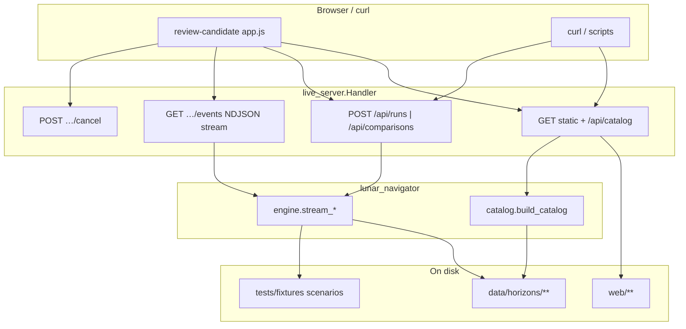
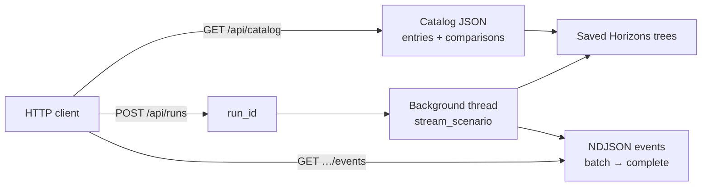
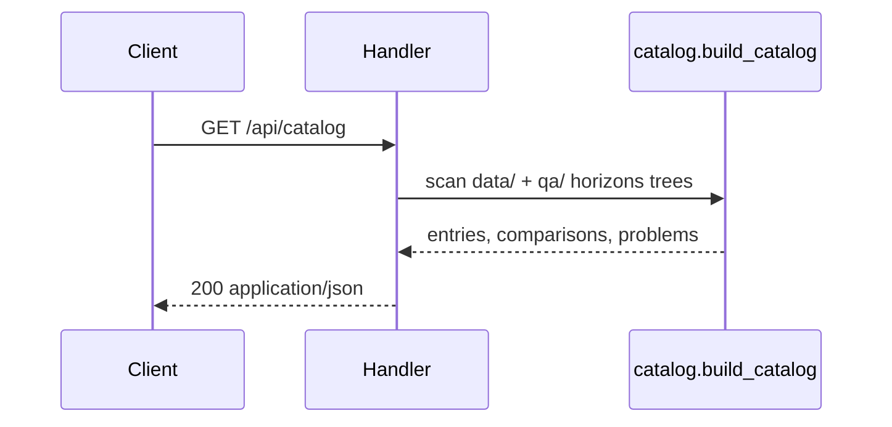
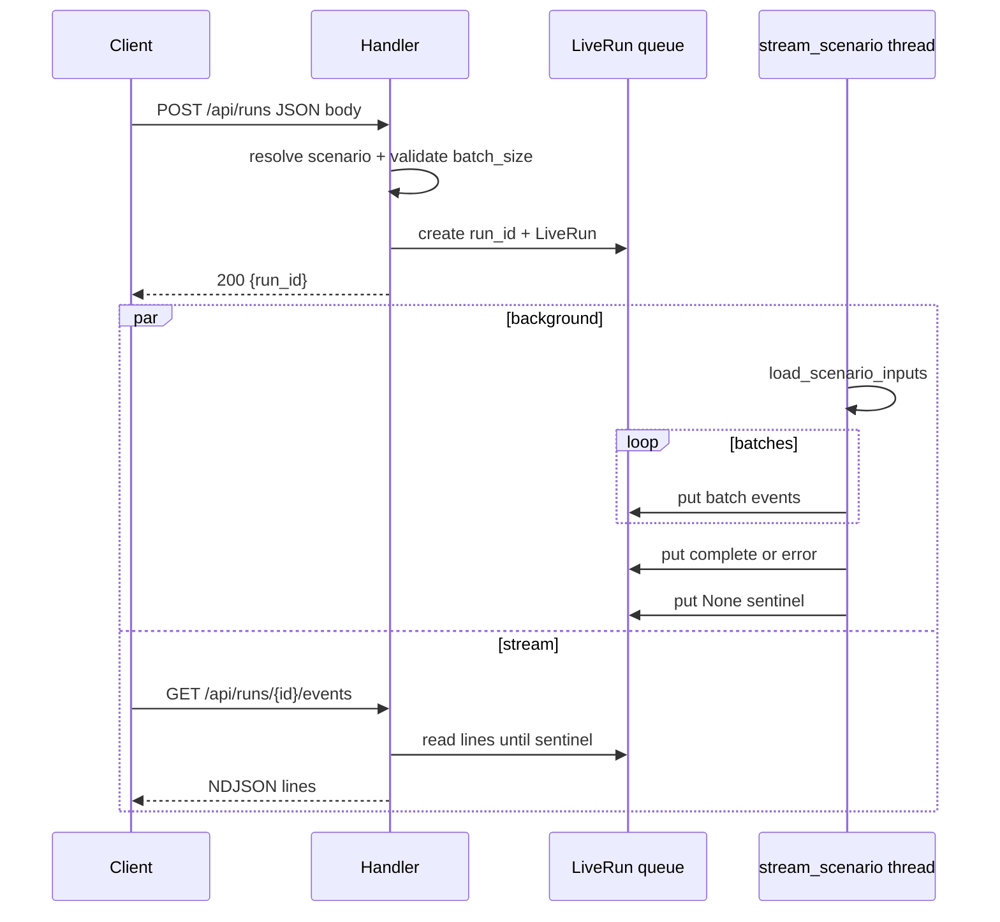
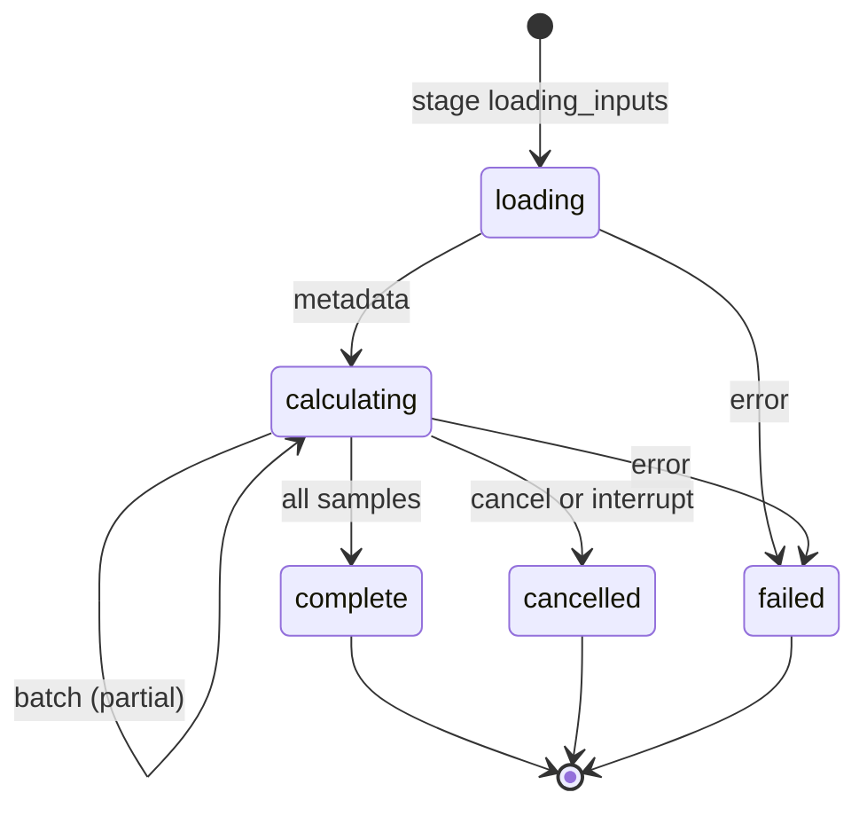
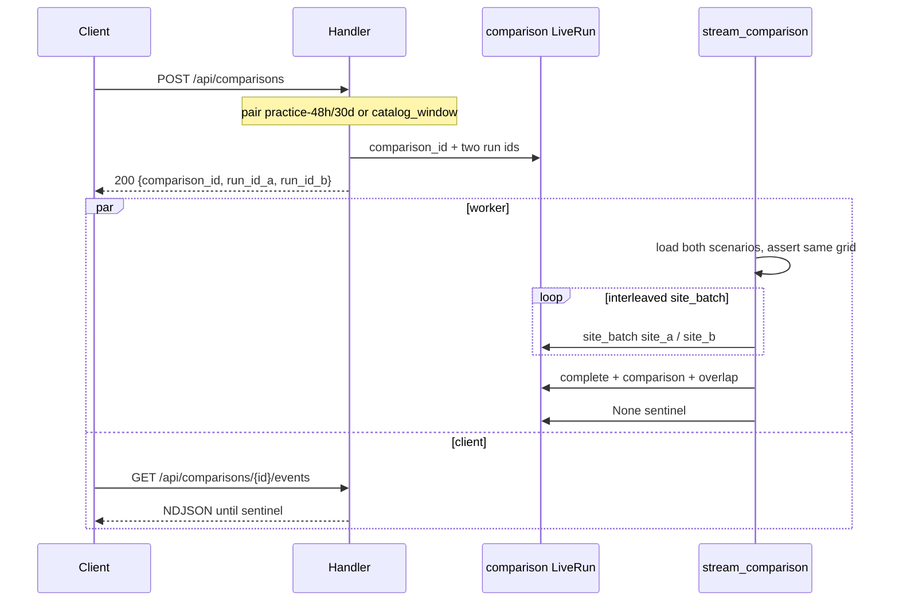
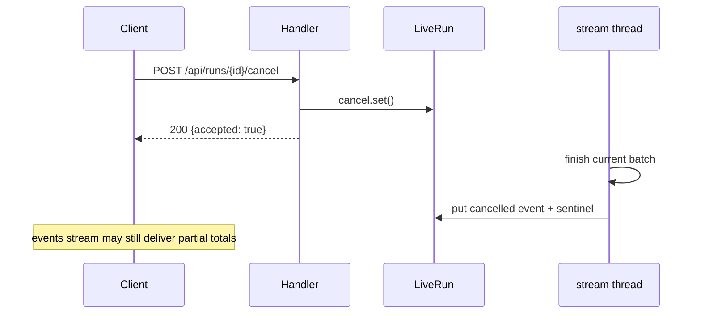

# API Reference — Lunar Landing Site Navigator (local server)

The local server is part of `lunar_navigator.cli serve`. It serves the landing page, the review UI, the witnessed replay, and a small JSON/NDJSON API for catalogues, single runs, and two-site comparisons. All endpoints are loopback-only (`127.0.0.1`).

Base URL for the examples below: `http://127.0.0.1:8766`.

## Architecture

The server binds **loopback only** (`127.0.0.1`). Static assets come from `web/`; JSON and NDJSON from Python in `src/lunar_navigator/live_server.py`. Classification always goes through `engine.stream_scenario` / `engine.stream_comparison` on saved files under `data/` (default) or `qa/`.



### Context data flow (level 0)



### Endpoint map

| Method | Path | Response | Purpose |
|--------|------|----------|---------|
| `GET` | `/`, `/web/**` | static | Landing, navigator, replay, docs. |
| `GET` | `/api/catalog` | JSON | List classifiable entries and shared windows. |
| `POST` | `/api/runs` | JSON `{run_id}` | Start single-site stream. |
| `GET` | `/api/runs/{id}/events` | NDJSON | Stream run events until `complete`/`cancelled`/`error`. |
| `POST` | `/api/runs/{id}/cancel` | JSON | Request cancel after current batch. |
| `POST` | `/api/comparisons` | JSON ids | Start two-site stream. |
| `GET` | `/api/comparisons/{id}/events` | NDJSON | `site_batch` × N then `complete` with overlap. |
| `POST` | `/api/comparisons/{id}/cancel` | JSON | Cancel comparison worker. |

## Start the server

```sh
cd /home/m9nx/Lunar-Hackathon
PYTHONPATH=src python3 -m lunar_navigator.cli --revision "$(python3 builder/scripts/record_revision.py --label)" serve --port 8766
```

Leave the terminal open. The server does not call JPL; it reads the saved Horizons exports under `data/horizons/`.

## Content types

- `GET` for static files (HTML, CSS, JS, JSON, images, Markdown) under `web/`.
- `GET /api/catalog` returns `application/json`.
- `POST /api/runs` and `POST /api/comparisons` return `application/json`.
- `GET /api/runs/{id}/events` and `GET /api/comparisons/{id}/events` return `application/x-ndjson`: one JSON object per line.
- `POST /api/runs/{id}/cancel` and `POST /api/comparisons/{id}/cancel` return `application/json`.

## GET /api/catalog

Returns every saved Horizons entry and every shared two-site window that the engine can compare. A `problems` list explains entries that failed integrity checks.



### Request

```sh
curl -s http://127.0.0.1:8766/api/catalog | python3 -m json.tool | head -60
```

### Response (truncated)

```json
{
  "schema_version": "catalog-1",
  "scope_note": "Centre-ray geometric 0° comparisons from saved Horizons inputs.",
  "roots": ["data", "qa"],
  "entries": [
    {
      "id": "malapert-practice__20250101T000000Z__20250103T000000Z__900s",
      "site_id": "malapert-practice",
      "observer": {
        "longitude_east_deg": -2.93,
        "latitude_deg": -85.99,
        "height_km": 0.0,
        "height_reference": "Horizons SITE_COORD kilometres above the 1737.4 km reference sphere"
      },
      "coverage": {
        "start_utc": "2025-01-01T00:00:00Z",
        "end_utc": "2025-01-03T00:00:00Z",
        "step_seconds": 900,
        "sample_count": 193
      },
      "root_id": "data",
      "files": {
        "sun": "data/horizons/malapert-practice/sun-d10bfb555ec3/response.json",
        "earth": "data/horizons/malapert-practice/earth-062e67d0fdf0/response.json"
      },
      "practice": true,
      "eligible_for_submission_claim": false
    }
  ],
  "comparisons": [
    {
      "id": "malapert-practice__20250101T000000Z__20250103T000000Z__900s++site04-p02-practice__20250101T000000Z__20250103T000000Z__900s",
      "a": "malapert-practice__20250101T000000Z__20250103T000000Z__900s",
      "b": "site04-p02-practice__20250101T000000Z__20250103T000000Z__900s",
      "coverage": {
        "start_utc": "2025-01-01T00:00:00Z",
        "end_utc": "2025-01-03T00:00:00Z",
        "step_seconds": 900,
        "sample_count": 193
      }
    }
  ],
  "problems": []
}
```

## POST /api/runs

Start a single-site streamed run from a saved catalog entry or a named scenario. The response gives a `run_id`; connect to `/api/runs/{run_id}/events` for results.

### Body fields

| Field | Required? | Type | Meaning |
|-------|-----------|------|---------|
| `catalog` | one of | string | Catalog entry id from `/api/catalog`. |
| `scenario` | one of | string | Named scenario: `site04-48h`, `site04-6h`, `malapert-48h`, `site04-30d`, `malapert-30d`. |
| `start_utc` | optional | string | Sub-range start, must be on the saved grid. |
| `end_utc` | optional | string | Sub-range end, must be on the saved grid. |
| `horizon_mode` | optional | string | `geometric_0deg` (default) or `terrain`. |
| `batch_size` | optional | int | 1–500, default 4. |
| `pause_seconds` | optional | float | 0–5, default 0. |
| `fail_after_batches` | optional | int | Test hook: emit an error after this many batches. |

`catalog` and `scenario` are mutually exclusive. A bad `horizon_mode`, an unknown entry, or an off-grid range returns HTTP 400 with an `error` field.



### Example: named scenario

```sh
curl -s -X POST http://127.0.0.1:8766/api/runs \
  -H "Content-Type: application/json" \
  -d '{"scenario":"site04-48h","batch_size":4}'
```

Response:

```json
{"run_id": "a1b2c3d4e5f6"}
```

### Example: catalog sub-range

```sh
curl -s -X POST http://127.0.0.1:8766/api/runs \
  -H "Content-Type: application/json" \
  -d '{
    "catalog": "site04-p02-practice__20250103T000000Z__20250110T000000Z__900s",
    "start_utc": "2025-01-03T00:00:00Z",
    "end_utc": "2025-01-10T00:00:00Z"
  }'
```

## GET /api/runs/{run_id}/events

Server-sent NDJSON stream. The server keeps events in memory only; if you close the connection you cannot resume.

### Event sequence



1. `stage` — `loading_inputs`.
2. `metadata` — scenario, observer, sample count, labels, `practice`, `eligible_for_submission_claim`.
3. Zero or more `batch` events, each with a list of classified samples.
4. Exactly one of:
   - `complete` — full result is available.
   - `cancelled` — the caller cancelled or the run was interrupted.
   - `error` — input validation or calculation failure.

### Batch event fields

```json
{
  "event": "batch",
  "run_id": "a1b2c3d4e5f6",
  "result_run_id": "site04-p02-practice-q4-centre-0deg-...",
  "batch_index": 0,
  "stage": "calculating",
  "complete": false,
  "partial": true,
  "samples": [ ... ],
  "samples_emitted": 4,
  "elapsed_seconds": { "sun": { ... }, "earth": { ... }, "both": { ... } },
  "intervals": [ ... ],
  "cutoff_utc": "2025-01-01T01:00:00Z",
  "covered_through_utc": "2025-01-01T01:15:00Z"
}
```

Each sample contains:

```json
{
  "timestamp_utc": "2025-01-01T00:00:00Z",
  "duration_seconds": 900,
  "sun": {
    "azimuth_deg": 318.623526,
    "elevation_deg": 1.680511,
    "horizon_deg": 0.0,
    "margin_deg": 1.680511,
    "state": "clear",
    "reason": "centre_above_horizon",
    "label": "Sun-centre clearance",
    "source_ref": "horizons/site04-p02-practice/sun-e6cd9548480a/angles.csv#row=2",
    "response_line": "2025-Jan-01 00:00,*,i, 318.623526,     1.680511,"
  },
  "earth": { ... },
  "both": { "state": "blocked", "reason": "centre_below_or_on_horizon:sun+earth", "label": "Both centres clear" }
}
```

`complete: false` and `partial: true` on every batch mean: the numbers are valid for the samples shown, but the run is not finished.

## POST /api/comparisons

Start a two-site comparison. The response contains `comparison_id`, `run_id_a`, and `run_id_b`.



### Body fields

| Field | Required? | Type | Meaning |
|-------|-----------|------|---------|
| `catalog_window` | one of | string | Shared two-site window id from `/api/catalog`. |
| `pair` | one of | string | `practice-48h` (default) or `practice-30d`. |
| `scenario_a`, `scenario_b` | optional | string | Override the pair’s default single scenarios. |
| `start_utc`, `end_utc` | optional | string | Sub-range, only valid with `catalog_window`. |
| `horizon_mode` | optional | string | `geometric_0deg` or `terrain`. |
| `batch_size_a`, `batch_size_b` | optional | int | Defaults to `batch_size` or 4. |
| `fail_after_batches_a`, `fail_after_batches_b` | optional | int | Test hooks. |

### Example: practice 48 h pair

```sh
curl -s -X POST http://127.0.0.1:8766/api/comparisons \
  -H "Content-Type: application/json" \
  -d '{"pair":"practice-48h"}'
```

Response:

```json
{
  "comparison_id": "a1b2c3d4e5f6",
  "run_id_a": "a1a1a1a1a1a1",
  "run_id_b": "b2b2b2b2b2b2"
}
```

### Example: catalog window (Jan 3–10)

```sh
curl -s -X POST http://127.0.0.1:8766/api/comparisons \
  -H "Content-Type: application/json" \
  -d '{
    "catalog_window": "malapert-practice__20250103T000000Z__20250110T000000Z__900s++site04-p02-practice__20250103T000000Z__20250110T000000Z__900s"
  }'
```

## GET /api/comparisons/{comparison_id}/events

NDJSON stream with `site_batch` events for each site, followed by a single `complete` event that contains both finished runs and the comparison document.

### `site_batch` fields

```json
{
  "event": "site_batch",
  "comparison_id": "a1b2c3d4e5f6",
  "role": "site_a",
  "run_id": "a1a1a1a1a1a1",
  "result_run_id": "malapert-practice-q4-centre-0deg-...",
  "batch_index": 0,
  "stage": "calculating",
  "complete": false,
  "partial": true,
  "samples": [ ... ],
  "samples_emitted": 4,
  "elapsed_seconds": { ... },
  "intervals": [ ... ],
  "cutoff_utc": "...",
  "covered_through_utc": "..."
}
```

### `complete` fields

```json
{
  "event": "complete",
  "comparison_id": "a1b2c3d4e5f6",
  "run_id_a": "a1a1a1a1a1a1",
  "run_id_b": "b2b2b2b2b2b2",
  "result_run_id_a": "malapert-practice-q4-centre-0deg-...",
  "result_run_id_b": "site04-p02-practice-q4-centre-0deg-...",
  "stage": "complete",
  "complete": true,
  "partial": false,
  "result_a": { ... },
  "result_b": { ... },
  "comparison": { ... },
  "shared_samples": 673,
  "overlap": {
    "sun_centre_clear_seconds": { "site_a": 397800, "site_b": 604800, "delta_b_minus_a": 207000 },
    "both_centres_clear_seconds": { "site_a": 397800, "site_b": 333900, "delta_b_minus_a": -63900 },
    "unknown_seconds": { ... }
  }
}
```

The `comparison` object has the same shape as `web/review-candidate/cases/practice-jan03-10/comparison.json`.

## POST /api/runs/{run_id}/cancel

Request cancellation. The engine finishes the current batch and then emits a `cancelled` event.



```sh
curl -s -X POST http://127.0.0.1:8766/api/runs/a1b2c3d4e5f6/cancel
```

Response:

```json
{"id": "a1b2c3d4e5f6", "accepted": true}
```

## POST /api/comparisons/{comparison_id}/cancel

Same shape for comparisons.

## Partial and completed output

- **Partial:** every `batch`/`site_batch` carries `elapsed_seconds`, `intervals`, `cutoff_utc`, and `covered_through_utc`. Totals cover only samples up to `cutoff_utc`.
- **Completed:** the `complete` event contains the full run payload (`result_a`, `result_b`) and the comparison export. The UI enables “Download complete export” only after this event.
- **Failed or cancelled:** no export is produced. The totals shown are explicitly labelled partial or incomplete.

## HTTP status codes

| Status | Meaning |
|--------|---------|
| 200 | Success for GET/POST API and static files. |
| 400 | Bad request body, unknown id, off-grid range, incompatible grids, or unsupported `horizon_mode`. Body: `{"error": "..."}`. |
| 404 | Unknown run/comparison id or static file not found. |

## Error handling

| Stage | HTTP | NDJSON `event` | Client action |
|-------|------|----------------|---------------|
| Bad body / unknown catalog id | 400 JSON `error` | — | Fix request; no `run_id` created. |
| Unknown run/comparison id | 404 JSON | — | Start a new run. |
| Validation during load | — | `error` | Show message; no export. |
| User cancel | 200 cancel ack | `cancelled` | Keep last partial batch totals. |
| Test hook `fail_after_batches` | — | `error` after N batches | Harness only. |

## Client usage notes

- The review UI opens an `EventSource`-style NDJSON reader over `/api/runs/{id}/events` and `/api/comparisons/{id}/events`. It does not use the browser’s built-in `EventSource` because the content type is `application/x-ndjson`.
- `batch_size` and `pause_seconds` only control pacing; they do not change classification.
- `terrain` mode returns `state: "unknown"` and `reason: "terrain_not_reviewed"` for every sample until M4 review passes.
