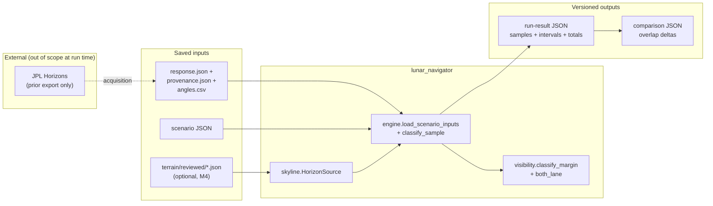
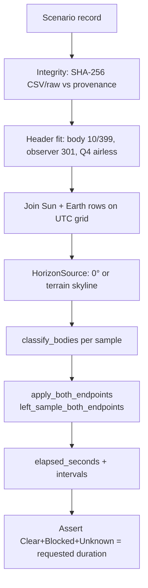
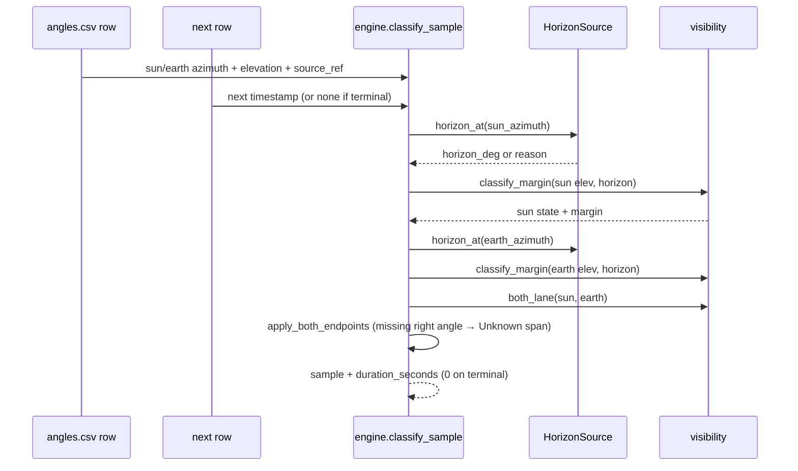
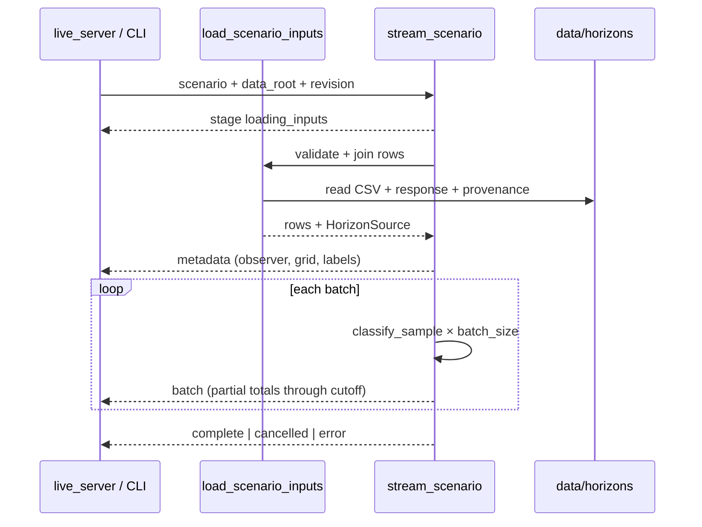

# Engine Reference — Lunar Landing Site Navigator

How the centre-ray engine turns a saved JPL Horizons row into a classified sample, an interval, and an export. For the API contract see [API Reference](api-reference.md). For data sources and terrain limits see [Data & Research](data-research.md).

## Architecture and data flow

The engine does not call JPL Horizons at classification time. It reads saved `response.json`, `provenance.json`, and `angles.csv` under `data/horizons/` (or `qa/`), validates them against the scenario, then classifies each timestamp. The review UI and the live server both consume the same `stream_scenario` / `geometric_run_from_rows` path; only packaging (batches vs one shot) differs.

### Context (level 0)



### Classification pipeline (level 1)



### Geometric calculation (what the numbers mean)

Horizons **Quantity 4** returns, for each UTC sample and each target body (Sun centre `10`, Earth centre `399`):

| Quantity | Symbol in export | Convention |
|----------|------------------|------------|
| Azimuth | `azimuth_deg` | Degrees clockwise from **true local north**, range `[0, 360)`. |
| Apparent airless elevation | `elevation_deg` | Degrees above the **local horizontal** plane at the lunar observer (`coord@301`). Refraction is off (airless). |

The observer sits at `SITE_COORD`: east longitude, latitude, and height **kilometres above the 1737.4 km reference sphere** (practice files use the values in each scenario). The angles are already in the observer’s topocentric frame (`MEAN_ME` in the saved headers); the engine does **not** recompute ephemeris or rotate vectors.

**Geometric 0° mode** (`horizon_mode: geometric_0deg`):

```
horizon_deg = 0.0
margin_deg  = elevation_deg - horizon_deg
```

**Terrain mode** (`horizon_mode: terrain`) — selectable but M4-not-passed in this release:

```
H = skyline horizon angle at the body’s azimuth (linear interp between bins, 359°↔0° wrap)
margin_deg = elevation_deg - H   only when H is defined
```

If no approved skyline matches the observer, every sample is `unknown` with reason `terrain_not_reviewed`; `horizon_deg` and `margin_deg` stay `null` and the saved elevation is kept. A gap in either bracketing azimuth bin yields `terrain_gap_in_azimuth_bracket` (no invented fill).

**Diagnostic DEM profiles** (`lunar_navigator.terrain`, LDEM sampling) build display-only skylines under `web/review-candidate/terrain/`. They do not feed `HorizonSource` until Science signs a reviewed `terrain/reviewed/*.json` file.

**Classification rule** (unrounded margin):

```
clear   if margin_deg > 0
blocked if margin_deg ≤ 0   (includes exact contact)
unknown if elevation or required horizon is missing
```

**Both lane** after per-body states and endpoint checks:

```
blocked if either body is blocked
else unknown if either body is unknown
else clear
```

### Sequence: classify one timestamp



### Sequence: load scenario and emit (streamed run)



### Module map

| Module | Role |
|--------|------|
| `horizons_table.py` | Parse CSV/response text; map `n.a.` to null angles. |
| `engine.py` | Validation, join, classify, intervals, streaming, comparison export. |
| `visibility.py` | Margin → state; body ID guardrails; Both-lane priority. |
| `skyline.py` | Reviewed skyline lookup; azimuth interpolation; terrain Unknown reasons. |
| `terrain.py` | DEM skyline **diagnostics** only (not production classification). |
| `catalog.py` | Discover saved entries and comparable two-site windows. |

## What the engine calculates

For each saved timestamp, for each of Sun (`10`) and Earth (`399`):

```
margin_deg = apparent_airless_elevation_deg - horizon_deg
```

```
state = clear   if margin_deg > 0
        blocked if margin_deg <= 0
        unknown if the angle is missing for that body and time
```

The **Both** lane is then:

```
blocked if either body is blocked
unknown if neither is blocked and either body is unknown
clear   only if both bodies are clear
```

Classification uses the **unrounded** margin. Display rounding never changes a state. A margin of exactly `0°` is `blocked`.

## Input acceptance

Before any sample is classified the engine checks:

1. **File integrity** — the saved `response.json` SHA-256 matches `provenance.json`.
2. **Header convention** — target body is `10` or `399`, observer is `coord@301`, quantities include `4`, `Atmos refraction: NO (AIRLESS)`, and the angle columns are azimuth/apparent elevation in degrees.
3. **Scenario fit** — target, observer coordinates/height, frame, UTC window, and cadence match the scenario record.
4. **Grid validity** — timestamps are unique and on the declared step; malformed numbers or conflicting duplicates are rejected with an error naming the file.

A valid scenario with missing rows keeps the requested grid and marks affected samples `unknown` with a reason. Missing numbers are `null`; `0°` is a real angle.

## Worked sample: Site04, 2025-01-01T00:00:00Z

### 1. Validation

Scenario `tests/fixtures/site04_p02_practice_scenario.json` requires:

- Observer: east longitude `203.5614°`, latitude `-89.7812°`, height `1.738902 km` above the 1737.4 km reference sphere.
- Target bodies: Sun `10`, Earth `399`.
- UTC window: `2025-01-01T00:00:00Z` → `2025-01-03T00:00:00Z`, step `900 s`.
- Frame: `MEAN_ME`, airless angles.

The saved files pass the integrity and header checks.

### 2. Raw Horizons rows

Sun (`data/horizons/site04-p02-practice/sun-8a039d445c7f/response.json`):

```text
2025-Jan-01 00:00,*, , 318.623526,     1.683925,
```

- Azimuth: `318.623526°` clockwise from true local north.
- Apparent airless elevation: `1.683925°`.

Earth (`data/horizons/site04-p02-practice/earth-167962cea6a2/response.json`):

```text
2025-Jan-01 00:00,*, , 151.799812,    -6.503228,
```

- Azimuth: `151.799812°`.
- Apparent airless elevation: `-6.503228°`.

### 3. Horizon

Geometric 0° mode sets `horizon_deg = 0.0` for both bodies.

### 4. Margin

Sun: `1.683925 - 0.0 = 1.683925°` → `> 0` → `clear`.

Earth: `-6.503228 - 0.0 = -6.503228°` → `≤ 0` → `blocked`.

### 5. Both lane

Sun is clear, Earth is blocked → Both lane is `blocked` (`centre_below_or_on_horizon:sun+earth`).

### 6. Interval (left-sample, both-endpoints)

Each sample represents a half-open interval `[t, t + step)` except the final sample, which represents `0 s`. A sample’s state counts only when both the sample and the next sample have usable angles for that body. For this 48 h window:

- 193 samples at 15-minute cadence.
- 192 intervals × 900 s = 172,800 s = 48 h.
- The last sample adds 0 s.

For Site04 over the full 48 h:

| Lane | Clear | Blocked | Unknown | Total |
|------|-------|---------|---------|-------|
| Sun  | 172,800 s | 0 s | 0 s | 172,800 s |
| Earth | 0 s | 172,800 s | 0 s | 172,800 s |
| Both | 0 s | 172,800 s | 0 s | 172,800 s |

### 7. Export row

The sample appears in `web/replay/runs/site04-p02-practice.json` (witnessed replay, revision `1f3fb06`) as:

```json
{
  "timestamp_utc": "2025-01-01T00:00:00Z",
  "duration_seconds": 900,
  "sun": {
    "azimuth_deg": 318.623526,
    "elevation_deg": 1.683925,
    "horizon_deg": 0.0,
    "margin_deg": 1.683925,
    "state": "clear",
    "reason": "centre_above_horizon",
    "source_ref": "horizons/site04-p02-practice/sun-8a039d445c7f/angles.csv#row=2"
  },
  "earth": { ... "state": "blocked", "reason": "centre_below_or_on_horizon" ... },
  "both": { "state": "blocked", "reason": "centre_below_or_on_horizon:sun+earth" }
}
```

## Missing angles and Unknown

If Horizons returns `n.a.` for a body at time `t`, the row is kept with `null` angles. Because of the both-endpoints rule, the interval ending at `t` and the interval starting at `t` are both `unknown` for that body. On a 15-minute grid, one missing sample at `00:30` creates 30 minutes of Unknown (`00:15`–`00:45`).

Reasons for Unknown:

| Reason | Meaning |
|--------|---------|
| `missing_right_endpoint` | The next sample’s angle is missing. |
| `missing_ephemeris` | This sample’s angle is missing. |
| `terrain_not_reviewed` | Terrain mode selected, no skyline review exists. |
| `terrain_no_skyline_for_observer` | No skyline file matches the observer. |
| `terrain_review_incomplete` | Reviewed skyline does not cover all required directions. |
| `terrain_gap_in_azimuth_bracket` | Adjacent azimuth bins lack samples, so interpolation is unsafe. |

## Exact contact and the terminal sample

- A margin of exactly `0°` is `blocked`.
- The terminal sample (the last timestamp in the requested window) carries `duration_seconds: 0`. It is still classified so the interval before it is closed, but it contributes no elapsed time.

## Both-state priority

The Both lane is computed from the individual body states after the missing-endpoint check:

1. If either body is `blocked`, Both is `blocked`.
2. Else if either body is `unknown`, Both is `unknown`.
3. Else both bodies are `clear`, so Both is `clear`.

This means a confirmed blocker in one body beats Unknown in the other for the Both lane.

## Terrain mode

Terrain mode is selectable in the UI and API, but the M4 review has not passed. The engine therefore returns `unknown` for every sample with reason `terrain_not_reviewed`. The elevation, azimuth, and source reference are still recorded; `horizon_deg` and `margin_deg` are `null`.

When a reviewed skyline exists, the engine will compare the target’s apparent elevation to `H(azimuth)`, the skyline angle at that azimuth. A populated azimuth bin alone does not establish continuity; gaps in the bracketing bins still make the sample Unknown (`terrain_gap_in_azimuth_bracket`).

## Intervals and totals

`intervals_from_samples` builds contiguous spans where state and reason are constant. Adjacent intervals with the same state but different reasons are merged for display but kept separate in the export. The elapsed-time totals are computed from `duration_seconds`, not from counting samples, so the terminal sample adds zero time.

## Reproducing a total by hand

From the saved CSV for Site04, 48 h, Sun lane:

- 193 rows, all with usable angles.
- All 192 non-terminal intervals are `clear`.
- Total clear = 192 × 900 s = 172,800 s = 48 h.

The notebook `docs/notebooks/01_trace_observation_to_interval_total.ipynb` repeats this calculation independently from the CSV files and compares against the engine export.

## Precision rules

- Times are ISO 8601 UTC ending in `Z`.
- Azimuth is clockwise from true local north in `[0, 360)` degrees.
- Elevation is relative to the local horizontal in degrees.
- The margin used for classification is unrounded.
- Display values are rounded; rounding never changes the state.
